# Awesome Claude SEO Skills

[中文](README.zh-CN.md)

Open-source **Claude SEO skills, SEO MCP servers and GEO tools** for Claude Code, Codex and other agents: all-in-one SEO skills, audits, keyword research, Search Console and SEO data MCP, AI search visibility, content writing and link building. 268 repos, each one read and security-graded by [Agent Skills Hub (agentskillshub.top)](https://agentskillshub.top).

Live page with filters: **[https://agentskillshub.top/best/seo-tools/](https://agentskillshub.top/best/seo-tools/)** · refreshed every 8 hours

## What these tools look like

<table>
<tr>
<td align="center" valign="top" width="33%"><b>🧰 All-in-one Claude SEO skills</b> 71 repos  <a href="https://github.com/NicoSKOOL/ai-ranking-scroll-seo">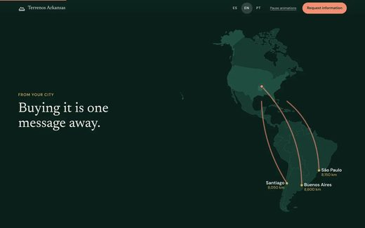</a> One skill or agent that covers audits, keywords, content and technical checks. <a href="#type-suite"><b>View the list →</b></a></td>
<td align="center" valign="top" width="33%"><b>🩺 SEO audit skills</b> 35 repos  <a href="https://github.com/AgriciDaniel/jev-seo">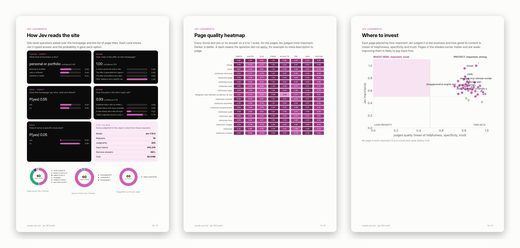</a> Crawl a site or read a page and list what to fix. <a href="#type-audit"><b>View the list →</b></a></td>
<td align="center" valign="top" width="33%"><b>🔎 Keyword research & rank tracking</b> 14 repos  <a href="https://github.com/getcheapapi/getcheapapi">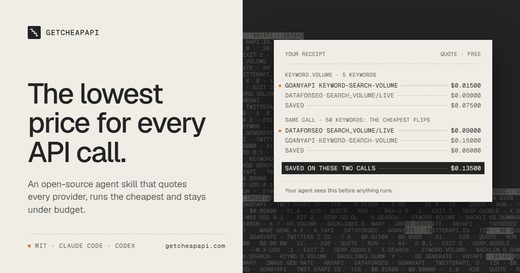</a> Keyword ideas, search demand and rank tracking. <a href="#type-research"><b>View the list →</b></a></td>
</tr>
<tr>
<td align="center" valign="top" width="33%"><b>🔌 SEO data MCP & monitoring dashboards</b> 31 repos  <a href="https://github.com/duckduckdeploy/openseo">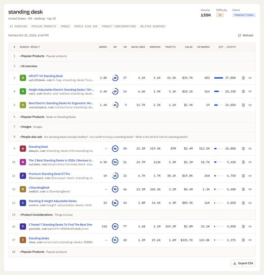</a> Search Console, crawl and SEO-database data for your agent, and self-hosted dashboards. <a href="#type-data_mcp"><b>View the list →</b></a></td>
<td align="center" valign="top" width="33%"><b>🤖 GEO & AI search visibility</b> 49 repos  <a href="https://github.com/Fangx-AI/geo-doctor">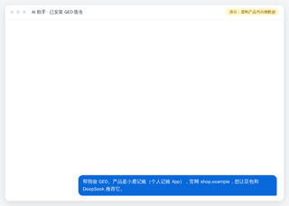</a> Visibility in AI answers: GEO, AEO, citation tracking. <a href="#type-geo"><b>View the list →</b></a></td>
<td align="center" valign="top" width="33%"><b>✍️ SEO content writing</b> 23 repos  Articles, briefs and on-page copy written to rank. <a href="#type-content"><b>View the list →</b></a></td>
</tr>
<tr>
<td align="center" valign="top" width="33%"><b>🔗 Link building & backlink audits</b> 6 repos  <a href="https://github.com/m4mansoor/seo-agent">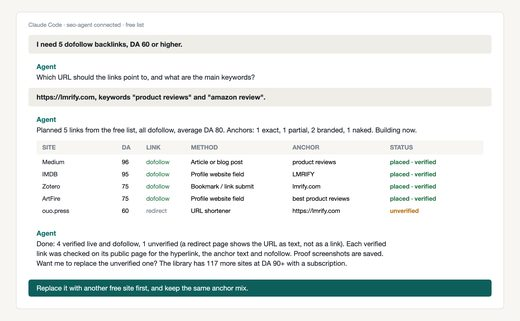</a> Link and PR openings, directory submission, and checks on link sources. <a href="#type-links"><b>View the list →</b></a></td>
<td align="center" valign="top" width="33%"><b>📣 Marketing skill packs with SEO</b> 39 repos  <a href="https://github.com/LuCheremisina/marketing-skills">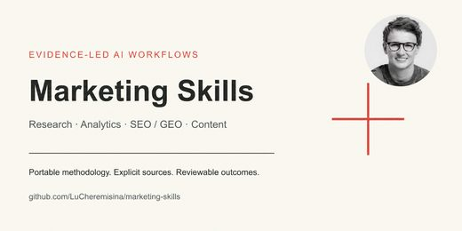</a> Broad marketing collections where SEO is one area. <a href="#type-marketing"><b>View the list →</b></a></td>
</tr>
</table>

## Contents

- [🧰 All-in-one Claude SEO skills](#type-suite) (71)
- [🩺 SEO audit skills](#type-audit) (35)
- [🔎 Keyword research & rank tracking](#type-research) (14)
- [🔌 SEO data MCP & monitoring dashboards](#type-data_mcp) (31)
- [🤖 GEO & AI search visibility](#type-geo) (49)
- [✍️ SEO content writing](#type-content) (23)
- [🔗 Link building & backlink audits](#type-links) (6)
- [📣 Marketing skill packs with SEO](#type-marketing) (39)

## How a repo gets on the list

1. SEO, or being found and cited in AI answers, is its main purpose, done through an agent. A site template that is only SEO-friendly, an SEO product with no agent interface, or a renamed copy of another repository does not count.
2. It is software someone can install or run, not a list of links or a placeholder.
3. It has a README. Without one it cannot be graded.
4. At 50 stars or more it is listed on topic alone. Under 50 it must also clear a README quality bar (shows it working, one-command start, a concrete outcome, complete docs), and have 5 stars.

The questions are answered by a decision model reading each README, not by hand. A repo near a cut-off can land on either side; open an issue if one is misfiled.

## 🧰 All-in-one Claude SEO skills

[Open this type on the live page, sorted by stars →](https://agentskillshub.top/best/seo-tools/#type-suite)

| Repo | Stars | What it does | Security |
|---|---:|---|---|
| [AgriciDaniel/claude-seo](https://github.com/AgriciDaniel/claude-seo) | 26.9k | Universal SEO skill for Claude Code. 26 sub-skills + 19 sub-agents covering technical SEO, E-E-A-T, schema, GEO/AEO, agent readiness (Lighthouse Agen… | [SAFE](https://agentskillshub.top/skill/AgriciDaniel/claude-seo/) |
| [Ryze-AI-Adgent/open-seo-mcp-skills](https://github.com/Ryze-AI-Adgent/open-seo-mcp-skills) | 8.9k | Free SEO MCP server + open-source SEO and GEO skills for Claude: keyword research, rank tracking, audits, backlinks, AI visibility on your real GSC/G… | [SAFE](https://agentskillshub.top/skill/Ryze-AI-Adgent/open-seo-mcp-skills/) |
| [AgriciDaniel/claude-blog](https://github.com/AgriciDaniel/claude-blog) | 2.7k | Free, open source blog writer for Claude Code. Researches current sources, writes answer-first posts for Google and AI answers, has an independent re… | [SAFE](https://agentskillshub.top/skill/AgriciDaniel/claude-blog/) |
| [leopard627/fire-your-seo-agency](https://github.com/leopard627/fire-your-seo-agency) | 995 | Fire your SEO·GEO agency 🔥 A Claude Code skill that audits and optimizes SEO·AEO·GEO·LLMO·NEO(Naver) by itself — 월 50~350만 원짜리 'AI 검색 최적화' 대행, AI 에이전… | [SAFE](https://agentskillshub.top/skill/leopard627/fire-your-seo-agency/) |
| [AgriciDaniel/chatgpt-seo](https://github.com/AgriciDaniel/chatgpt-seo) | 902 | Turn a page, draft, or SEO export into a sourced fix plan inside ChatGPT. | [SAFE](https://agentskillshub.top/skill/AgriciDaniel/chatgpt-seo/) |
| [Illyism/seo-skills](https://github.com/Illyism/seo-skills) | 703 | SEO skills for Claude Code, Cursor and Codex: SEO autopilot, title tags, blog refreshes, backlinks, customer journeys, video transcripts and copywrit… | [SAFE](https://agentskillshub.top/skill/Illyism/seo-skills/) |
| [joeseesun/qiaomu-seo](https://github.com/joeseesun/qiaomu-seo) | 471 | Audit, diagnose, research, plan, implement, experiment on, and verify website SEO across Google, Bing, and AI-search surfaces. Use for technical SEO, | [SAFE](https://agentskillshub.top/skill/joeseesun/qiaomu-seo/) |
| [ViryaZheng/recomby-geo](https://github.com/ViryaZheng/recomby-geo) | 454 | GEO 领域 AI 员工开源方案 · Open-source GEO AI-employee solution (MIT). GEO Skills package + curated lists of agents and office CLIs that make up the AI-emplo… | [SAFE](https://agentskillshub.top/skill/ViryaZheng/recomby-geo/) |
| [inhouseseo/superseo-skills](https://github.com/inhouseseo/superseo-skills) | 383 | 11 Claude skills for SEO: page audits, linkbuilding, article writing, E-E-A-T audits, semantic gap analysis, link building. Methodology from Koray Tu… | [SAFE](https://agentskillshub.top/skill/inhouseseo/superseo-skills/) |
| [mars-tw/open-seo-advisor-skill](https://github.com/mars-tw/open-seo-advisor-skill) | 354 | 開源、可攜、不綁定單一廠商的全域 SEO 顧問技能 - 蒸餾 SEO 權威方法論，協助任何產業做 SEO 健檢、修復、內容產出 | [SAFE](https://agentskillshub.top/skill/mars-tw/open-seo-advisor-skill/) |
| [beyondtahir/beyondseo](https://github.com/beyondtahir/beyondseo) | 252 | Your AI SEO house. Audit your website, write useful content, compare competitors and plan backlinks inside your AI assistant. Free and open source. | [SAFE](https://agentskillshub.top/skill/beyondtahir/beyondseo/) |
| [aaron-he-zhu/seo-geo-claude-skills](https://github.com/aaron-he-zhu/seo-geo-claude-skills) | 240 | Signpost → the 16 SEO/GEO agent skills live in aaron-marketing-skills; this repo's standalone 20-skill line is preserved at tag v9.9.12. Install: npx… | [SAFE](https://agentskillshub.top/skill/aaron-he-zhu/seo-geo-claude-skills/) |
| [yan-labs/yan-skills](https://github.com/yan-labs/yan-skills) | 232 | Yan's agent skills collection — Google Trends SEO workflows, AI news, autopilot, and more. For Claude Code / Codex / Cursor. | [SAFE](https://agentskillshub.top/skill/yan-labs/yan-skills/) |
| [Bomx/distribb-skill](https://github.com/Bomx/distribb-skill) | 204 | Distribb CLI, Claude, Codex, Hermes, OpenClaw skill for AI-powered SEO. Write content with your own AI, publish through Distribb's backlink network. | [SAFE](https://agentskillshub.top/skill/Bomx/distribb-skill/) |
| [seranking/seo-skills](https://github.com/seranking/seo-skills) | 199 | Claude SEO Skills — production Claude Agent Skills for the SE Ranking MCP server. Content briefs, AI Search share of voice, audits, backlink gaps, ke… | [SAFE](https://agentskillshub.top/skill/seranking/seo-skills/) |
| [akseolabs-seo/seo-coach](https://github.com/akseolabs-seo/seo-coach) | 197 | An open-source AI SEO coach for beginners: practice on your own website, make evidence-based decisions, and track verifiable progress without expensi… | [SAFE](https://agentskillshub.top/skill/akseolabs-seo/seo-coach/) |
| [zubair-trabzada/dataforseo-claude](https://github.com/zubair-trabzada/dataforseo-claude) | 175 | SEO Agency Killer for Claude Code — powered by DataForSEO. 13 skills + 5 subagents for keyword research, rank tracking, backlink audits, technical cr… | [SAFE](https://agentskillshub.top/skill/zubair-trabzada/dataforseo-claude/) |
| [yaojingang/GEOHub](https://github.com/yaojingang/GEOHub) | 170 | GEOHub: open, evidence-bounded GEO and SEO agent skills for AI Search, with research-grounded discovery, diagnosis, content, measurement, and one-lin… | [SAFE](https://agentskillshub.top/skill/yaojingang/GEOHub/) |
| [zhtyyx/codex-seo](https://github.com/zhtyyx/codex-seo) | 152 | Free, open-source SEO audits inside OpenAI Codex CLI. Port of claude-seo: 26 skills, 19 specialist roles, technical SEO / schema / GEO / local / ecom… | [SAFE](https://agentskillshub.top/skill/zhtyyx/codex-seo/) |
| [AgriciDaniel/seo-os](https://github.com/AgriciDaniel/seo-os) | 149 | SEO Office is a local-first SEO agency operating system. claw3d UI + claude-seo specialists + marketing-brain. Distributed as a private repo to a non… | [SAFE](https://agentskillshub.top/skill/AgriciDaniel/seo-os/) |
| [garrettjsmith/localseoskills](https://github.com/garrettjsmith/localseoskills) | 146 | Open-source Claude SEO tool for local search visibility — skills, tool integrations, and automation templates that turn Claude into a Local SEO exper… | [SAFE](https://agentskillshub.top/skill/garrettjsmith/localseoskills/) |
| [deepakness/google-ai-search-optimization](https://github.com/deepakness/google-ai-search-optimization) | 141 | Unofficial Agent Skill based on Google Search guidance for AI Overviews, AI Mode, and SEO audits. | [SAFE](https://agentskillshub.top/skill/deepakness/google-ai-search-optimization/) |
| [AKCodez/seo-god](https://github.com/AKCodez/seo-god) | 123 | Turn Claude Code into an agentic SEO operator for your own site — audit, measure, daily loop, AI visibility, scheduled runs. Free path, no paid keys. | [SAFE](https://agentskillshub.top/skill/AKCodez/seo-god/) |
| [Houseofmvps/ultraship](https://github.com/Houseofmvps/ultraship) | 123 | "ULTRASHIP" Claude Code plugin — 39 skills, 33 tools, 11 agents for ship-ready workflows: planning, review, pentesting, safety guardrails, canary mon… | [SAFE](https://agentskillshub.top/skill/Houseofmvps/ultraship/) |
| [IamRamgarhia/All-In-One-Free-SEO-Tool](https://github.com/IamRamgarhia/All-In-One-Free-SEO-Tool) | 119 | Free SEO tool — open-source, self-hosted alternative to Ahrefs, Semrush & Moz. 99 tools: site audits, rank tracking, keyword research, AI search visi… | [SAFE](https://agentskillshub.top/skill/IamRamgarhia/All-In-One-Free-SEO-Tool/) |
| [huifer/claude-code-seo](https://github.com/huifer/claude-code-seo) | 111 | Next.js SEO assistant plugin for Claude Code CLI. Automated SEO audits with 100-point scoring across 6 dimensions. Covers metadata, structured data,… | [SAFE](https://agentskillshub.top/skill/huifer/claude-code-seo/) |
| [jdevalk/skills](https://github.com/jdevalk/skills) | 111 | Agent skills for GitHub repos and profiles, WordPress and EmDash plugins, Astro SEO, and content readability. | [SAFE](https://agentskillshub.top/skill/jdevalk/skills/) |
| [TheMattBerman/seo-kit](https://github.com/TheMattBerman/seo-kit) | 100 | AI agent that finds keywords, writes content, monitors rankings, and self-improves. Two OpenClaw skills that chain into a compounding SEO loop. | [SAFE](https://agentskillshub.top/skill/TheMattBerman/seo-kit/) |
| [mykpono/ultimate-seo-geo](https://github.com/mykpono/ultimate-seo-geo) | 99 | The definitive SEO + GEO skill for Claude. Full site audits with scored findings, AI search optimization (Google AI Overviews, ChatGPT, Perplexity),… | [SAFE](https://agentskillshub.top/skill/mykpono/ultimate-seo-geo/) |
| [flaqai/Awesome_SEO_Writing_Skill](https://github.com/flaqai/Awesome_SEO_Writing_Skill) | 91 | Share the awesome skills for SEO Writing. All the skills are developed by Flaq AI Team | [SAFE](https://agentskillshub.top/skill/flaqai/Awesome_SEO_Writing_Skill/) |
| [nikhilbhansali/dataforseo-skill-claude](https://github.com/nikhilbhansali/dataforseo-skill-claude) | 68 | DataForSEO API skill for Claude Code - Complete SEO data integration | [SAFE](https://agentskillshub.top/skill/nikhilbhansali/dataforseo-skill-claude/) |
| [norahe0304-art/30x-seo](https://github.com/norahe0304-art/30x-seo) | 58 | 23 production-ready SEO skills for Claude Code. Technical SEO, content optimization, keyword research, backlink analysis, and AI visibility monitorin… | [SAFE](https://agentskillshub.top/skill/norahe0304-art/30x-seo/) |
| [dannwaneri/seo-agent](https://github.com/dannwaneri/seo-agent) | 57 | Open-source SEO audit agent — real-browser checks, backlink scoring, and multi-engine AI citation tracking (Claude, ChatGPT, Gemini, Perplexity, Copi… | [SAFE](https://agentskillshub.top/skill/dannwaneri/seo-agent/) |
| [southwellmedia/seo-audit](https://github.com/southwellmedia/seo-audit) | 53 | Claude Skill for SEO Audit & PDF Export | [SAFE](https://agentskillshub.top/skill/southwellmedia/seo-audit/) |
| [199-biotechnologies/claude-skill-seo-geo-optimizer](https://github.com/199-biotechnologies/claude-skill-seo-geo-optimizer) | 52 | Production-ready Claude skill for comprehensive SEO/GEO optimization. Analyzes content for traditional search engines + AI platforms (ChatGPT, Perple… | [SAFE](https://agentskillshub.top/skill/199-biotechnologies/claude-skill-seo-geo-optimizer/) |
| [XuanRanL/loamwright-SEO-Skill](https://github.com/XuanRanL/loamwright-SEO-Skill) | 52 | Production-grade SEO + GEO content factory for Claude Code — research, write, fact-check, optimize, publish to WordPress, monitor. Battle-tested by L… | [SAFE](https://agentskillshub.top/skill/XuanRanL/loamwright-SEO-Skill/) |
| [agencia-conversion/agentic-seo-skills](https://github.com/agencia-conversion/agentic-seo-skills) | 52 | Agentic SEO operating system as a Claude Code plugin: project Wiki, DataForSEO workflows, content briefs, technical SEO, and human-approval gates. | [SAFE](https://agentskillshub.top/skill/agencia-conversion/agentic-seo-skills/) |
| [sergekostenchuk/seo-llm-skill-cluster](https://github.com/sergekostenchuk/seo-llm-skill-cluster) | 40 | Task-plan driven SEO and LLM-friendly website skill cluster | [SAFE](https://agentskillshub.top/skill/sergekostenchuk/seo-llm-skill-cluster/) |
| [mangollc/claude-seo-skill](https://github.com/mangollc/claude-seo-skill) | 39 | Comprehensive SEO & AEO Claude Code plugin for agencies. Keyword research, technical audits, content optimization, local SEO, backlinks, and AI searc… | [SAFE](https://agentskillshub.top/skill/mangollc/claude-seo-skill/) |
| [NicoSKOOL/the-four-systems](https://github.com/NicoSKOOL/the-four-systems) | 37 | Four SEO skills you trigger from Claude Code. Each one updates a shared dashboard. Optional cron/launchd for hands-off mode. | [SAFE](https://agentskillshub.top/skill/NicoSKOOL/the-four-systems/) |
| [MariusYvard/NullToHero](https://github.com/MariusYvard/NullToHero) | 29 | Portable Agent Skills toolkit for Claude Code, Codex, Kimi and Hermes: web design, SEO/GEO, audits and deterministic mobile validation. | [SAFE](https://agentskillshub.top/skill/MariusYvard/NullToHero/) |
| [ziniman/ai-instruct](https://github.com/ziniman/ai-instruct) | 29 | Turn your AI assistant into a senior web developer. Production-ready guides for SEO, performance, and agent-readiness - for Claude Code, Cursor, Copi… | [SAFE](https://agentskillshub.top/skill/ziniman/ai-instruct/) |
| [bonnie-ship-it/AgriciDaniel-claude-seo](https://github.com/bonnie-ship-it/AgriciDaniel-claude-seo) | 23 |  | [CAUTION](https://agentskillshub.top/skill/bonnie-ship-it/AgriciDaniel-claude-seo/) |
| [lhitches/claude-seo-skills](https://github.com/lhitches/claude-seo-skills) | 22 | 60 free Claude Skills for SEO and AI search. Built by Hawk Academy + StudioHawk. Drop into Claude Desktop and run. | [SAFE](https://agentskillshub.top/skill/lhitches/claude-seo-skills/) |
| [lionkiii/claude-seo-skills](https://github.com/lionkiii/claude-seo-skills) | 22 | 42 SEO commands for Claude Code — site audits, Ahrefs backlinks, GSC analytics, SERP research, content briefs, technical SEO, schema validation, and… | [SAFE](https://agentskillshub.top/skill/lionkiii/claude-seo-skills/) |
| [calm-north/seojuice-skills](https://github.com/calm-north/seojuice-skills) | 21 | Deep SEO skills to run in Claude, Codex etc. | [SAFE](https://agentskillshub.top/skill/calm-north/seojuice-skills/) |
| [deeployCO/youtube-seo-skills](https://github.com/deeployCO/youtube-seo-skills) | 21 | Advanced YouTube SEO skill suite for Claude Code — 8 skills + helper scripts for audit, optimization, keywords, thumbnails, and competitor intelligen… | [SAFE](https://agentskillshub.top/skill/deeployCO/youtube-seo-skills/) |
| [seoskillsai/seo-skills-ai](https://github.com/seoskillsai/seo-skills-ai) | 21 | SEO Skills AI: Universal AI SEO Agent & Technical Optimization Suite across Claude Code, Antigravity, Cursor, Windsurf, Copilot, ChatGPT, and Cline. | [SAFE](https://agentskillshub.top/skill/seoskillsai/seo-skills-ai/) |
| [thebigasif/google-leak-patents-seo](https://github.com/thebigasif/google-leak-patents-seo) | 21 | The 2024 Google Content Warehouse API leak cross-referenced against 5,456 Google search patents. 848 classified ranking signals, 77,663 extracted pat… | [SAFE](https://agentskillshub.top/skill/thebigasif/google-leak-patents-seo/) |
| [rankmyseo/skills](https://github.com/rankmyseo/skills) | 18 | Agent skills for SEO: plan, build, publish, and maintain a website with RankMySEO, Search Console, and GA4. | [SAFE](https://agentskillshub.top/skill/rankmyseo/skills/) |
| [searchfit/searchfit-seo](https://github.com/searchfit/searchfit-seo) | 14 | Free AI-powered SEO toolkit for Claude Code. Audit sites, plan content, optimize pages, track AI visibility, and more | [SAFE](https://agentskillshub.top/skill/searchfit/searchfit-seo/) |
| [jrr996shujin-png/openclaw-seo-aeo-skills](https://github.com/jrr996shujin-png/openclaw-seo-aeo-skills) | 13 | SEO & AEO skill pack for OpenClaw — diagnose website health, mine long-tail questions from Reddit/Quora, track keyword rankings & competitor content,… | [SAFE](https://agentskillshub.top/skill/jrr996shujin-png/openclaw-seo-aeo-skills/) |
| [lynnzc/loki-yan-seo-skill](https://github.com/lynnzc/loki-yan-seo-skill) | 13 | Unofficial Agent Skill from Loki Yan (@loki_yan_seo) public tweets. Google SEO / AIO / GEO diagnosis engine. Not affiliated. | [SAFE](https://agentskillshub.top/skill/lynnzc/loki-yan-seo-skill/) |
| [ApollosWave/gsc-cli](https://github.com/ApollosWave/gsc-cli) | 11 | First-party Google Search Console and technical SEO engine. Automate Googlebot indexing, audit Core Web Vitals, and capture Google AI Overviews in pu… | [SAFE](https://agentskillshub.top/skill/ApollosWave/gsc-cli/) |
| [kabde/seo-skills](https://github.com/kabde/seo-skills) | 11 | SEO Blogger Toolkit pour Claude Code - 15 skills pour WordPress : audit, redaction, publication, topic clusters, E-E-A-T, schema, GEO/IA | [SAFE](https://agentskillshub.top/skill/kabde/seo-skills/) |
| [saadsalmankhan/entity-seo-skill](https://github.com/saadsalmankhan/entity-seo-skill) | 11 | Rank a person or brand #1 for their own name — a Claude skill + playbook. On-site SEO, JSON-LD entity graph, off-site authority, and a free GSC rank… | [SAFE](https://agentskillshub.top/skill/saadsalmankhan/entity-seo-skill/) |
| [s87343472/one-page-one-keyword](https://github.com/s87343472/one-page-one-keyword) | 10 | SEO keyword layout optimization skill for Claude | [SAFE](https://agentskillshub.top/skill/s87343472/one-page-one-keyword/) |
| [IncomeStreamSurfer/seo-night-skill](https://github.com/IncomeStreamSurfer/seo-night-skill) | 8 | Free Claude Code / OpenCode skill that fixes AI-slop SEO: one command, one commit per change | [SAFE](https://agentskillshub.top/skill/IncomeStreamSurfer/seo-night-skill/) |
| [NicoSKOOL/ai-ranking-scroll-seo](https://github.com/NicoSKOOL/ai-ranking-scroll-seo) | 8 | Claude Code skill: premium scroll-driven websites that also rank. WebP budgets, schema, keyword-matched H1, Lighthouse 95+, agentic browsing. | [SAFE](https://agentskillshub.top/skill/NicoSKOOL/ai-ranking-scroll-seo/) |
| [kevinwowo/waimao-seo-audit](https://github.com/kevinwowo/waimao-seo-audit) | 8 | 外贸独立站 SEO 体检 — 整站审计、关键词聚类、Fan-Out 覆盖度、可白标 HTML 报告 + Excel。同时是 Claude Code 插件(seo-audit skill)。MIT。 | [SAFE](https://agentskillshub.top/skill/kevinwowo/waimao-seo-audit/) |
| [sunlin-xiaonai/web-cafe-seo-agent-skill](https://github.com/sunlin-xiaonai/web-cafe-seo-agent-skill) | 8 | Use the Web.Cafe SEO Agent from Codex with hidden browser execution and in-chat results. | [SAFE](https://agentskillshub.top/skill/sunlin-xiaonai/web-cafe-seo-agent-skill/) |
| [ouranos-labs/pseolint](https://github.com/ouranos-labs/pseolint) | 7 | SpamBrain-proof your pSEO before you publish, audit page relationships, not just pages. AI-triaged findings, 8 LLM providers, local telemetry, cost c… | [SAFE](https://agentskillshub.top/skill/ouranos-labs/pseolint/) |
| [shalintripathi/organic-os](https://github.com/shalintripathi/organic-os) | 7 | Run an always-on SEO/AEO growth loop on your own site with Claude: pulls GA4 and Search Console signals, proposes fixes with the reasoning attached,… | [SAFE](https://agentskillshub.top/skill/shalintripathi/organic-os/) |
| [AndreasH96/seo-geo-consultant](https://github.com/AndreasH96/seo-geo-consultant) | 6 | Claude Code plugin: Senior SEO & GEO consultant. Audits, strategizes, and implements technical SEO, structured data, and AI search visibility for Saa… | [SAFE](https://agentskillshub.top/skill/AndreasH96/seo-geo-consultant/) |
| [CrazySwami/wordpress-dev-skills](https://github.com/CrazySwami/wordpress-dev-skills) | 6 | Complete WordPress development and automation toolkit for Claude Code - Docker, Playground, white-labeling, SEO, visual QA, and performance optimizat… | [SAFE](https://agentskillshub.top/skill/CrazySwami/wordpress-dev-skills/) |
| [affilino/ecommerce-seo-audit-skill](https://github.com/affilino/ecommerce-seo-audit-skill) | 6 |  | [SAFE](https://agentskillshub.top/skill/affilino/ecommerce-seo-audit-skill/) |
| [nexscope-ai/ecommerce-seo-geo-skills](https://github.com/nexscope-ai/ecommerce-seo-geo-skills) | 6 | Portable skills for ecommerce SEO, GEO readiness, structured data, product-listing optimization, keyword gaps, and buyer-intent content. | [SAFE](https://agentskillshub.top/skill/nexscope-ai/ecommerce-seo-geo-skills/) |
| [rocketmandrey/seo-standup](https://github.com/rocketmandrey/seo-standup) | 6 | SEO без магии: скилл для AI-агента + 15-минутный стендап о проектировании сайта под существующий спрос. Zero paid APIs. | [SAFE](https://agentskillshub.top/skill/rocketmandrey/seo-standup/) |
| [venomous2/opencode-seo](https://github.com/venomous2/opencode-seo) | 6 | AI-native SEO platform for OpenCode: deterministic rule engine, SEO linting with CI gates, a fix engine, citation scoring, drift monitoring, and clie… | [SAFE](https://agentskillshub.top/skill/venomous2/opencode-seo/) |
| [oegeyilmaz9/seo-aeo-geo-ultimate](https://github.com/oegeyilmaz9/seo-aeo-geo-ultimate) | 5 | Evidence-first SEO, AEO, GEO and AI-search workflows for Codex and Claude Code — one router, 27 focused skills. | [SAFE](https://agentskillshub.top/skill/oegeyilmaz9/seo-aeo-geo-ultimate/) |
| [owensky-dev/seo-gsc-ga4-analyst](https://github.com/owensky-dev/seo-gsc-ga4-analyst) | 5 | Codex skill for local SEO analysis with Google Search Console and GA4 data. | [SAFE](https://agentskillshub.top/skill/owensky-dev/seo-gsc-ga4-analyst/) |

## 🩺 SEO audit skills

[Open this type on the live page, sorted by stars →](https://agentskillshub.top/best/seo-tools/#type-audit)

<table><tr>
<td align="center" valign="top"><a href="https://github.com/wojcikdominik/openspider">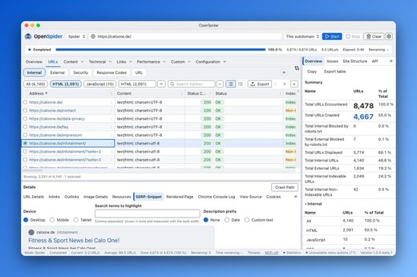</a> <a href="https://github.com/wojcikdominik/openspider">wojcikdominik/openspider</a></td>
</tr></table>

| Repo | Stars | What it does | Security |
|---|---:|---|---|
| [Bhanunamikaze/Agentic-SEO-Skill](https://github.com/Bhanunamikaze/Agentic-SEO-Skill) | 1.0k | An LLM-first SEO analysis skill for Antigravity, Codex, Claude with 16 specialized sub-skills, 10 specialist agents, and 88 optional utility scripts… | [SAFE](https://agentskillshub.top/skill/Bhanunamikaze/Agentic-SEO-Skill/) |
| [tigerless-labs/seo-ops](https://github.com/tigerless-labs/seo-ops) | 986 | SEO foundation checks as an Agent Skill: give it a URL, get a crawler's-eye pass/fail report with evidence. 26 structural checks, zero LLM, determini… | [SAFE](https://agentskillshub.top/skill/tigerless-labs/seo-ops/) |
| [JeffLi1993/seo-audit-skill](https://github.com/JeffLi1993/seo-audit-skill) | 782 | SEO agent skill for OpenClaw,Claude Code, and AI agents. Generate beginner SEO audits and advanced technical SEO reports for any page. | [SAFE](https://agentskillshub.top/skill/JeffLi1993/seo-audit-skill/) |
| [AgriciDaniel/jev-seo](https://github.com/AgriciDaniel/jev-seo) | 756 | Live SEO audit for any website from one homepage URL, judged by Jev. PDF, XLSX and Markdown reports. | [SAFE](https://agentskillshub.top/skill/AgriciDaniel/jev-seo/) |
| [seo-skills/seo-audit-skill](https://github.com/seo-skills/seo-audit-skill) | 661 | A comprehensive SEO audit command-line tool with 332 audit rules across 20 categories. Analyze any website for SEO best practices, Core Web Vitals, s… | [SAFE](https://agentskillshub.top/skill/seo-skills/seo-audit-skill/) |
| [iannuttall/seo](https://github.com/iannuttall/seo) | 604 | SEO for agent-native teams. Your agent gets your real Search Console, Google Analytics, Bing and crawl data through an MCP server and CLI, so it stop… | [SAFE](https://agentskillshub.top/skill/iannuttall/seo/) |
| [umutxyp/Seo-Promt-Master](https://github.com/umutxyp/Seo-Promt-Master) | 571 | 🔍 Google SEO's full docs as an AI prompt machine — drop it into your AI assistant to map every public route, audit each page against Google's rules,… | [SAFE](https://agentskillshub.top/skill/umutxyp/Seo-Promt-Master/) |
| [squirrelscan/squirrelscan](https://github.com/squirrelscan/squirrelscan) | 307 | The website QA tool for your coding agent. 310+ audit rules across SEO, performance, security, accessibility and agent experience. | [SAFE](https://agentskillshub.top/skill/squirrelscan/squirrelscan/) |
| [SNLabat/SEO-GEO-AEO-Skill](https://github.com/SNLabat/SEO-GEO-AEO-Skill) | 278 | SEO/GEO/AEO Audit Skill for Claude | [SAFE](https://agentskillshub.top/skill/SNLabat/SEO-GEO-AEO-Skill/) |
| [aleksandr-alhoff/seo-landing](https://github.com/aleksandr-alhoff/seo-landing) | 207 | SEO Landing: Give your AI coding agent the capabilities of a senior Technical SEO engineer. An agent skill for building high-performance, technically… | [SAFE](https://agentskillshub.top/skill/aleksandr-alhoff/seo-landing/) |
| [spronta/crawlie](https://github.com/spronta/crawlie) | 117 | Fast, free, open-source technical SEO + GEO crawler: built for humans and agents. | [SAFE](https://agentskillshub.top/skill/spronta/crawlie/) |
| [squirrelscan/skills](https://github.com/squirrelscan/skills) | 106 | Agent skills for squirrelscan, the website QA tool for your coding agent (300+ audit rules). | [SAFE](https://agentskillshub.top/skill/squirrelscan/skills/) |
| [Snippet-Digital-Agency/tech-seo-audit-skill](https://github.com/Snippet-Digital-Agency/tech-seo-audit-skill) | 68 | Technical SEO Audit skill for Claude | [SAFE](https://agentskillshub.top/skill/Snippet-Digital-Agency/tech-seo-audit-skill/) |
| [adityaarsharma/sitewalk](https://github.com/adityaarsharma/sitewalk) | 47 | Sitewalk: SEO Audit & Site Crawler. 30+ technical SEO checks. Use it in ChatGPT with no install, or self-host the open-source crawler and MCP server… | [SAFE](https://agentskillshub.top/skill/adityaarsharma/sitewalk/) |
| [Horosheff/google-yandex-seo-skill](https://github.com/Horosheff/google-yandex-seo-skill) | 42 | Self-contained Cursor/OpenClaw SEO audit skill for Google and Yandex. | [SAFE](https://agentskillshub.top/skill/Horosheff/google-yandex-seo-skill/) |
| [spruikco/fat-agent-skill](https://github.com/spruikco/fat-agent-skill) | 40 | FAT Agent (Fix, Audit, Test) — a Claude Skill that automates post-launch website QA. Audits SEO, security, accessibility, performance, and more. | [SAFE](https://agentskillshub.top/skill/spruikco/fat-agent-skill/) |
| [AndacGuven/technical-seo-skill](https://github.com/AndacGuven/technical-seo-skill) | 34 | This project is a production-oriented technical SEO auditing skill built to behave like a real technical SEO specialist, not a simple crawler. It dis… | [SAFE](https://agentskillshub.top/skill/AndacGuven/technical-seo-skill/) |
| [iklynow-hue/seo-geo-skills](https://github.com/iklynow-hue/seo-geo-skills) | 28 | SEO/GEO site audit skill for Codex and Claude Code with capped crawling, template-aware sampling, and bilingual HTML reporting powered by local Light… | [SAFE](https://agentskillshub.top/skill/iklynow-hue/seo-geo-skills/) |
| [wonfull888/seo-audit](https://github.com/wonfull888/seo-audit) | 28 | SEO Audit Skill is an AI-powered SEO auditing tool based on Google Search guidelines and the Ahrefs SEO checklist. Runs in any skill-enabled CLI (Cla… | [SAFE](https://agentskillshub.top/skill/wonfull888/seo-audit/) |
| [annygabb/pagespeed-seo-optimizer](https://github.com/annygabb/pagespeed-seo-optimizer) | 20 | Skill para otimizar Performance, SEO, Acessibilidade e Boas Práticas de sites com PageSpeed Insights e Lighthouse. | [SAFE](https://agentskillshub.top/skill/annygabb/pagespeed-seo-optimizer/) |
| [wojcikdominik/openspider](https://github.com/wojcikdominik/openspider) | 18 | The crawler for the agentic era – open-source website crawler & technical SEO auditor for AI agents and humans (macOS, Windows). Rust + Tauri, MCP-na… | [SAFE](https://agentskillshub.top/skill/wojcikdominik/openspider/) |
| [sodam-ai/SoDam-SeoMedic](https://github.com/sodam-ai/SoDam-SeoMedic) | 16 | Claude Code 플러그인 — 웹사이트 SEO/GEO 진단(크롤·렌더·CWV·구조화데이터·AI크롤러정책·회귀감지) + GSC/GA4/PSI 연동. Next.js 프로젝트 승인 기반 자동수정(canonical·OG·noindex·robots·JSON-LD·제목·메타… | [SAFE](https://agentskillshub.top/skill/sodam-ai/SoDam-SeoMedic/) |
| [spcaeo/toadstone](https://github.com/spcaeo/toadstone) | 11 | A self-hosted alternative to Screaming Frog: your crawl, your machine, no per-URL pricing and no seats. 222 SEO checks — 180 of them proven to fire a… | [SAFE](https://agentskillshub.top/skill/spcaeo/toadstone/) |
| [wishfy-ai/google-seo-geo-aeo-audit-skill](https://github.com/wishfy-ai/google-seo-geo-aeo-audit-skill) | 11 | Audit your website for all AI Search best practices google recommends for SEO,GEO,AEO | [SAFE](https://agentskillshub.top/skill/wishfy-ai/google-seo-geo-aeo-audit-skill/) |
| [mario-hernandez/crawlforge](https://github.com/mario-hernandez/crawlforge) | 9 | Open source alternative to Screaming Frog SEO Spider — LLM-native, MCP server included, 269 rules, DuckDB+Parquet storage, MIT licensed. | [SAFE](https://agentskillshub.top/skill/mario-hernandez/crawlforge/) |
| [Haniubub/seo-toolkit](https://github.com/Haniubub/seo-toolkit) | 8 | The SEO audit toolkit built for DeepSeek Harness (DSH) — runs locally, no Claude Code, no API key required. Self-contained port of claude-seo v2.2.5:… | [SAFE](https://agentskillshub.top/skill/Haniubub/seo-toolkit/) |
| [seobeast-co/seobeast-audit](https://github.com/seobeast-co/seobeast-audit) | 8 | Full-site SEO audit — 140+ rules, 20 categories. Claude Code skill + @seobeast/seo-audit npm library. TypeScript, ESM, no browser required. | [SAFE](https://agentskillshub.top/skill/seobeast-co/seobeast-audit/) |
| [mikiarlo3/enso-SEO-GEO](https://github.com/mikiarlo3/enso-SEO-GEO) | 7 | A new Claude skill for SEO/GEO audit | [SAFE](https://agentskillshub.top/skill/mikiarlo3/enso-SEO-GEO/) |
| [Mehmoodqureshi/seo-tools-mcp](https://github.com/Mehmoodqureshi/seo-tools-mcp) | 6 | SEO toolkit as an MCP server — free, keyless on-page audits, robots.txt, sitemaps, structured data, broken-link checks, and PageSpeed insights | [SAFE](https://agentskillshub.top/skill/Mehmoodqureshi/seo-tools-mcp/) |
| [Shantodotdev/blacksparrow](https://github.com/Shantodotdev/blacksparrow) | 6 | Blazingly fast, local-first website crawler and 120-rule technical SEO audit engine with native MCP support. | [SAFE](https://agentskillshub.top/skill/Shantodotdev/blacksparrow/) |
| [ducrz/seo-audit-marketplace](https://github.com/ducrz/seo-audit-marketplace) | 6 | Auditoria SEO com notas por critérios Google e Bing — skill/plugin open source para Claude Code | [SAFE](https://agentskillshub.top/skill/ducrz/seo-audit-marketplace/) |
| [JittoJoseph/seo-skills](https://github.com/JittoJoseph/seo-skills) | 5 | Free, open-source Shopify SEO audit for Claude Code, Codex and Cursor. Check any store or site from its URL: what Google and AI crawlers can read, an… | [SAFE](https://agentskillshub.top/skill/JittoJoseph/seo-skills/) |
| [Luzikov/codex-seo-skill](https://github.com/Luzikov/codex-seo-skill) | 5 | SEO audit skill for Codex with technical SEO, schema, AI search, and Next.js codebase review. | [SAFE](https://agentskillshub.top/skill/Luzikov/codex-seo-skill/) |
| [jgoullet/seo-geo-audit](https://github.com/jgoullet/seo-geo-audit) | 5 | SEO-GEO Skill System for Claude Code & Claude.ai — 5 connected skills: Collector → Auditor (/90) → Implementer → Monitor. Technical SEO, Core Web Vit… | [SAFE](https://agentskillshub.top/skill/jgoullet/seo-geo-audit/) |
| [vdalhambra/siteaudit-mcp](https://github.com/vdalhambra/siteaudit-mcp) | 5 | Instant SEO, performance, and security audits for any URL — an MCP server for AI agents | [SAFE](https://agentskillshub.top/skill/vdalhambra/siteaudit-mcp/) |

## 🔎 Keyword research & rank tracking

[Open this type on the live page, sorted by stars →](https://agentskillshub.top/best/seo-tools/#type-research)

<table><tr>
<td align="center" valign="top"> <a href="https://github.com/avalonreset/legends-geogrid">avalonreset/legends-geogrid</a></td>
<td align="center" valign="top"><a href="https://github.com/avalonreset/legends-dataforseo">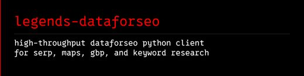</a> <a href="https://github.com/avalonreset/legends-dataforseo">avalonreset/legends-dataforseo</a></td>
</tr></table>

| Repo | Stars | What it does | Security |
|---|---:|---|---|
| [zhuyansen/new-term-radar](https://github.com/zhuyansen/new-term-radar) | 2.1k | Daily radar for new AI terms: names of new models, products and repos, caught on X, Hugging Face, GitHub and sitemaps before keyword tools list them. | [SAFE](https://agentskillshub.top/skill/zhuyansen/new-term-radar/) |
| [AgriciDaniel/Keywordo-kun-AI-SEO-Agent-n8n-Workflow](https://github.com/AgriciDaniel/Keywordo-kun-AI-SEO-Agent-n8n-Workflow) | 83 | This workflow uses n8n, Gemini, and DataForSEO to create an AI agent that spies on your competitors, finds keyword gaps, and automates blog writing. | [SAFE](https://agentskillshub.top/skill/AgriciDaniel/Keywordo-kun-AI-SEO-Agent-n8n-Workflow/) |
| [avalonreset/legends-geogrid](https://github.com/avalonreset/legends-geogrid) | 35 | legends-geogrid: Agent-first open-source Google Maps rank checker, local rank tracker & GBP audit studio. Circular geo-grid maps & 18-page PDF local… | [SAFE](https://agentskillshub.top/skill/avalonreset/legends-geogrid/) |
| [Bomx/seo-keyword-research](https://github.com/Bomx/seo-keyword-research) | 22 | SEO Keyword Research AI Agent using Claude Code, OpenClaw, Hermes, Distribb or your preferred agentic system. It uses 3 methods, one free and two pai… | [SAFE](https://agentskillshub.top/skill/Bomx/seo-keyword-research/) |
| [seoutilsapp/seo-utils-skills](https://github.com/seoutilsapp/seo-utils-skills) | 12 | Custom skills for SEO Utils MCP server — helps AI assistants choose the right tools | [SAFE](https://agentskillshub.top/skill/seoutilsapp/seo-utils-skills/) |
| [getcheapapi/getcheapapi](https://github.com/getcheapapi/getcheapapi) | 10 | Open-source price router for paid data and media APIs: pick the cheapest provider per call, with budget guards for AI agents. | [SAFE](https://agentskillshub.top/skill/getcheapapi/getcheapapi/) |
| [hithereiamaliff/mcp-keywords-everywhere](https://github.com/hithereiamaliff/mcp-keywords-everywhere) | 10 | A Model Context Protocol (MCP) server that provides access to the Keywords Everywhere API for SEO research and keyword analysis. | [SAFE](https://agentskillshub.top/skill/hithereiamaliff/mcp-keywords-everywhere/) |
| [maciekpaszkiewicz/keyword-mapper](https://github.com/maciekpaszkiewicz/keyword-mapper) | 7 | 🗺️ Autonomous SEO keyword research & URL mapping agent for Claude Code. Fetches sitemap, queries DataForSEO, maps keywords to URLs with anti-cannibal… | [SAFE](https://agentskillshub.top/skill/maciekpaszkiewicz/keyword-mapper/) |
| [SerpstatGlobal/serpstat-mcp-skills](https://github.com/SerpstatGlobal/serpstat-mcp-skills) | 6 | Serpstat MCP Skills for Claude — SEO reports, competitive gap analysis, content strategy & quick wins in 2 minutes | [SAFE](https://agentskillshub.top/skill/SerpstatGlobal/serpstat-mcp-skills/) |
| [HasData/google-trends-mcp](https://github.com/HasData/google-trends-mcp) | 5 | Google Trends MCP server by HasData: interest over time, by region, and related queries and topics, as JSON. | [SAFE](https://agentskillshub.top/skill/HasData/google-trends-mcp/) |
| [JohnWayneeee/free-seo-mcp](https://github.com/JohnWayneeee/free-seo-mcp) | 5 | Free keyword research MCP server for Claude and Cursor. Pulls autocomplete, Google Trends, Bing search volume, Reddit threads and competitor sitemaps… | [SAFE](https://agentskillshub.top/skill/JohnWayneeee/free-seo-mcp/) |
| [avalonreset/legends-dataforseo](https://github.com/avalonreset/legends-dataforseo) | 5 | DataForSEO Python client and CLI for coding agents: Google SERP, Google Maps, Google Business Profile lookups, keyword volume research, and saved evi… | [SAFE](https://agentskillshub.top/skill/avalonreset/legends-dataforseo/) |
| [catorch/dataforseo-api-cli](https://github.com/catorch/dataforseo-api-cli) | 5 | Zero-dependency CLI for the DataForSEO API. | [SAFE](https://agentskillshub.top/skill/catorch/dataforseo-api-cli/) |
| [gbessoni/keyword-seo-agent](https://github.com/gbessoni/keyword-seo-agent) | 5 | Keyword research that scores by estimated monthly revenue, not search volume. ORCAS CTR data, intent-based conversion rates, AI Visibility scoring, h… | [SAFE](https://agentskillshub.top/skill/gbessoni/keyword-seo-agent/) |

## 🔌 SEO data MCP & monitoring dashboards

[Open this type on the live page, sorted by stars →](https://agentskillshub.top/best/seo-tools/#type-data_mcp)

| Repo | Stars | What it does | Security |
|---|---:|---|---|
| [every-app/open-seo](https://github.com/every-app/open-seo) | 26.5k | Open source alternative to Semrush and Ahrefs | [SAFE](https://agentskillshub.top/skill/every-app/open-seo/) |
| [AminForou/mcp-gsc](https://github.com/AminForou/mcp-gsc) | 2.1k | Google Search Console Insights with Claude AI for SEOs | [SAFE](https://agentskillshub.top/skill/AminForou/mcp-gsc/) |
| [crawlseo/crawlseo](https://github.com/crawlseo/crawlseo) | 674 | Open-source SEO monitoring. GSC + Site Crawler + Core Web Vitals in one dashboard. | [SAFE](https://agentskillshub.top/skill/crawlseo/crawlseo/) |
| [springvoiceswell/semrush-ai-tool](https://github.com/springvoiceswell/semrush-ai-tool) | 536 | Semrush SEO AI-powered analysis tool MCP server & CLI for keyword research, domain analytics, backlink analysis | [SAFE](https://agentskillshub.top/skill/springvoiceswell/semrush-ai-tool/) |
| [avansaber/seo-monster](https://github.com/avansaber/seo-monster) | 511 | SEOMonster: a local, user-credential-driven MCP server for SEO workflows over Google Search Console, GA4, PageSpeed Insights, and Cloudflare. Read-fi… | [SAFE](https://agentskillshub.top/skill/avansaber/seo-monster/) |
| [saurabhsharma2u/search-console-mcp](https://github.com/saurabhsharma2u/search-console-mcp) | 320 | Search & analytics data as infrastructure — MCP server for Google Search Console, Bing Webmaster Tools, Google Adsense and GA4, designed for AI agent… | [SAFE](https://agentskillshub.top/skill/saurabhsharma2u/search-console-mcp/) |
| [ahonn/mcp-server-gsc](https://github.com/ahonn/mcp-server-gsc) | 283 | A Model Context Protocol (MCP) server providing access to Google Search Console | [SAFE](https://agentskillshub.top/skill/ahonn/mcp-server-gsc/) |
| [cnych/seo-mcp](https://github.com/cnych/seo-mcp) | 260 | A free SEO tool MCP (Model Control Protocol) service based on Ahrefs data. Includes features such as backlinks, keyword ideas, and more. | [SAFE](https://agentskillshub.top/skill/cnych/seo-mcp/) |
| [dataforseo/mcp-server-typescript](https://github.com/dataforseo/mcp-server-typescript) | 260 | DataForSEO API modelcontextprotocol server | [SAFE](https://agentskillshub.top/skill/dataforseo/mcp-server-typescript/) |
| [egebese/dataseo-mcp](https://github.com/egebese/dataseo-mcp) | 193 | A free SEO research tool using Model Context Protocol (MCP) powered by Ahrefs data. Get backlink analysis, keyword research, traffic estimation, and… | [SAFE](https://agentskillshub.top/skill/egebese/dataseo-mcp/) |
| [Suganthan-Mohanadasan/Suganthans-GSC-MCP](https://github.com/Suganthan-Mohanadasan/Suganthans-GSC-MCP) | 176 | An MCP server for Google Search Console. Ask Claude questions about your search data and get real answers. 29 tools: quick wins, cannibalisation, con… | [SAFE](https://agentskillshub.top/skill/Suganthan-Mohanadasan/Suganthans-GSC-MCP/) |
| [houtini-ai/seo-audit](https://github.com/houtini-ai/seo-audit) | 97 | Free SEO Audit MCP server for Claude - captures and stores all the raw data you need for a complete technical SEO audit. Google Search Console + a fi… | [SAFE](https://agentskillshub.top/skill/houtini-ai/seo-audit/) |
| [NeoZi12/dispatchseo](https://github.com/NeoZi12/dispatchseo) | 96 | Turn your AI agent into your SEO manager - works today with Claude Code, Codex, and Cursor. The open-source alternative to SEObot and Outrank | [SAFE](https://agentskillshub.top/skill/NeoZi12/dispatchseo/) |
| [bzsasson/screaming-frog-mcp](https://github.com/bzsasson/screaming-frog-mcp) | 94 | Headless MCP server for Screaming Frog SEO Spider – run crawls, export and analyze crawl data via the CLI. Small locked-down tool surface for schedul… | [SAFE](https://agentskillshub.top/skill/bzsasson/screaming-frog-mcp/) |
| [Skobyn/dataforseo-mcp-server](https://github.com/Skobyn/dataforseo-mcp-server) | 83 | A comprehensive stdio MCP server for DataForSEO API | [SAFE](https://agentskillshub.top/skill/Skobyn/dataforseo-mcp-server/) |
| [seyka-ai/yandex-tools-mcp](https://github.com/seyka-ai/yandex-tools-mcp) | 70 | MCP servers for Yandex APIs: Search, Wordstat, Webmaster, Metrika and Direct. Keyword research, SEO analytics and PPC management for Russian/CIS mark… | [SAFE](https://agentskillshub.top/skill/seyka-ai/yandex-tools-mcp/) |
| [fenjo26/OpenGSC](https://github.com/fenjo26/OpenGSC) | 54 | Self-hosted Google Search Console dashboard — rank tracking, keyword research, AI-visibility audits and an AI SEO content suite. Includes a 105-tool… | [CAUTION](https://agentskillshub.top/skill/fenjo26/OpenGSC/) |
| [Suganthan-Mohanadasan/Suganthans-BigQuery-MCP-Server](https://github.com/Suganthan-Mohanadasan/Suganthans-BigQuery-MCP-Server) | 44 | BigQuery MCP server for Claude — query any BigQuery dataset in natural language, with built-in SEO analysis tools for GSC bulk export data | [SAFE](https://agentskillshub.top/skill/Suganthan-Mohanadasan/Suganthans-BigQuery-MCP-Server/) |
| [mrkooblu/semrush-mcp](https://github.com/mrkooblu/semrush-mcp) | 40 | A Model Context Protocol (MCP) server implementation that provides tools for accessing Semrush API data. | [SAFE](https://agentskillshub.top/skill/mrkooblu/semrush-mcp/) |
| [duckduckdeploy/openseo](https://github.com/duckduckdeploy/openseo) | 28 | Open Source Ahrefs & SEMrush | [SAFE](https://agentskillshub.top/skill/duckduckdeploy/openseo/) |
| [mshahiddigital/screamingfrog-audit-mcp](https://github.com/mshahiddigital/screamingfrog-audit-mcp) | 23 | Drive the Screaming Frog SEO Spider from Claude, Cursor, or any MCP client: headless crawls, a ranked issue register, derived analysis and a shareabl… | [SAFE](https://agentskillshub.top/skill/mshahiddigital/screamingfrog-audit-mcp/) |
| [itsjwill/seoctopus](https://github.com/itsjwill/seoctopus) | 12 | 8-armed SEO intelligence - MCP server + CLI with 23 tools for rank tracking, Google Analytics, site auditing, keyword research, competitive analysis,… | [SAFE](https://agentskillshub.top/skill/itsjwill/seoctopus/) |
| [acamolese/google-search-console-mcp](https://github.com/acamolese/google-search-console-mcp) | 9 | MCP server for Google Search Console: 17 read-only tools covering performance queries, quick wins, CTR gaps, cannibalisation, traffic-drop diagnosis… | [SAFE](https://agentskillshub.top/skill/acamolese/google-search-console-mcp/) |
| [benjaminard/s33k](https://github.com/benjaminard/s33k) | 8 | Open, self-hosted, single-user SEO, AI-search (AEO), and analytics suite you run from your own LLM over MCP. A fork of SerpBear (MIT). | [SAFE](https://agentskillshub.top/skill/benjaminard/s33k/) |
| [harlan-zw/gscdump](https://github.com/harlan-zw/gscdump) | 8 | Dump your entire Google Search Console dataset and put your agents to work finding insights and improving your SEO. | [SAFE](https://agentskillshub.top/skill/harlan-zw/gscdump/) |
| [AKzar1el/mcp-gsc](https://github.com/AKzar1el/mcp-gsc) | 7 | Google Search Console MCP server for Claude, Cursor, ChatGPT, and any MCP client. Query clicks, impressions, average position, URL inspection, sitema… | [SAFE](https://agentskillshub.top/skill/AKzar1el/mcp-gsc/) |
| [Skobyn/mcp-dataforseo](https://github.com/Skobyn/mcp-dataforseo) | 7 | Model Context Protocol server for DataForSEO API | [SAFE](https://agentskillshub.top/skill/Skobyn/mcp-dataforseo/) |
| [lionkiii/google-searchconsole-mcp](https://github.com/lionkiii/google-searchconsole-mcp) | 7 | MCP server for Google Search Console — query search analytics, inspect URLs, find keyword opportunities, track SEO performance. Works with Claude Des… | [SAFE](https://agentskillshub.top/skill/lionkiii/google-searchconsole-mcp/) |
| [sudomichael/search-console-mcp](https://github.com/sudomichael/search-console-mcp) | 7 | Google Search Console for Claude, Cursor & any MCP client — one sign-in, 30 seconds, no Google Cloud project. Read-only by construction. | [SAFE](https://agentskillshub.top/skill/sudomichael/search-console-mcp/) |
| [zizzfizzix/mcp-server-bwt](https://github.com/zizzfizzix/mcp-server-bwt) | 7 | Model Context Protocol (MCP) server for Bing Webmaster Tools (BWT) allowing Claude.ai and other clients to interact with the BWT API | [SAFE](https://agentskillshub.top/skill/zizzfizzix/mcp-server-bwt/) |
| [theYahia/yandex-webmaster-mcp](https://github.com/theYahia/yandex-webmaster-mcp) | 6 | MCP server for Yandex Webmaster — SEO, indexing, search queries (Russia). Part of WWmcp — 114 MCP servers for emerging markets. | [SAFE](https://agentskillshub.top/skill/theYahia/yandex-webmaster-mcp/) |

## 🤖 GEO & AI search visibility

[Open this type on the live page, sorted by stars →](https://agentskillshub.top/best/seo-tools/#type-geo)

<table><tr>
<td align="center" valign="top"><a href="https://github.com/jayanti-prajapati/research-first-writer">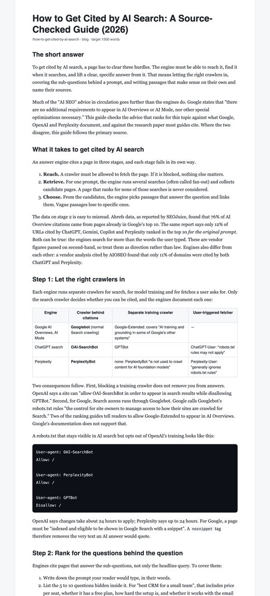</a> <a href="https://github.com/jayanti-prajapati/research-first-writer">jayanti-prajapati/research-first-writer</a></td>
</tr></table>

| Repo | Stars | What it does | Security |
|---|---:|---|---|
| [zubair-trabzada/geo-seo-claude](https://github.com/zubair-trabzada/geo-seo-claude) | 11.5k | GEO-first SEO skill for Claude Code. Comprehensive AI search optimization for any website — citability scoring, AI crawler analysis, brand authority,… | [SAFE](https://agentskillshub.top/skill/zubair-trabzada/geo-seo-claude/) |
| [onvoyage-ai/gtm-engineer-skills](https://github.com/onvoyage-ai/gtm-engineer-skills) | 1.4k | Claude Code skill for improving website AEO (AI Engine Optimization) and GEO (Generative Engine Optimization) scores — 16 foundational checks, 6 inte… | [SAFE](https://agentskillshub.top/skill/onvoyage-ai/gtm-engineer-skills/) |
| [Auriti-Labs/geo-optimizer-skill](https://github.com/Auriti-Labs/geo-optimizer-skill) | 1.3k | GEO Optimizer, the open-source engine behind GeoReady (geoready.dev): audit whether ChatGPT, Perplexity, Gemini & Google AI Overviews cite your site.… | [SAFE](https://agentskillshub.top/skill/Auriti-Labs/geo-optimizer-skill/) |
| [yaojingang/yao-geo-skills](https://github.com/yaojingang/yao-geo-skills) | 914 | An open-source Skill collection for GEO content and workflows, continuously updated. | [SAFE](https://agentskillshub.top/skill/yaojingang/yao-geo-skills/) |
| [elmohq/elmo](https://github.com/elmohq/elmo) | 570 | Open-source Answer Engine Optimization (AEO) and Generative Engine Optimization (GEO) platform. Track how ChatGPT, Claude, Perplexity, Gemini, Copilo… | [SAFE](https://agentskillshub.top/skill/elmohq/elmo/) |
| [ai-search-guru/getcito-worlds-first-open-source-aio-aeo-or-geo-tool](https://github.com/ai-search-guru/getcito-worlds-first-open-source-aio-aeo-or-geo-tool) | 449 | GetCito the World's First Open Source AI Search Optimization (AIO) / Answer Engine Optimization (AEO) or Generative Engine Optimization (GEO) and AI… | [SAFE](https://agentskillshub.top/skill/ai-search-guru/getcito-worlds-first-open-source-aio-aeo-or-geo-tool/) |
| [limelit-co/open](https://github.com/limelit-co/open) | 377 | Self-hosted AI visibility tracking (AEO / GEO / LLMO). Track how ChatGPT, Claude, Perplexity, Gemini and Google AI Overviews mention and cite your br… | [SAFE](https://agentskillshub.top/skill/limelit-co/open/) |
| [addyosmani/agentic-seo](https://github.com/addyosmani/agentic-seo) | 342 | Agentic SEO / Agentic Engine Optimization (AEO) tools | [SAFE](https://agentskillshub.top/skill/addyosmani/agentic-seo/) |
| [Fangx-AI/geo-doctor](https://github.com/Fangx-AI/geo-doctor) | 305 | GEO 医生：一句话装进 AI 助手，查清豆包、DeepSeek、ChatGPT、Claude 为什么不推荐你，改资料、写内容、再复查。开源中英双语 GEO（生成式引擎优化）skill。 | [SAFE](https://agentskillshub.top/skill/Fangx-AI/geo-doctor/) |
| [ALLENLION35/geo-first-principles](https://github.com/ALLENLION35/geo-first-principles) | 301 | GEO第一性原理：面向企业负责人的开源 GEO 分析 Skill。从行业竞争、客户需求与成交逻辑出发，判断是否适合做 GEO、价值在哪里、怎样投入，并提供重点场景、五题实测指引与行动建议。支持 Agent Skills 格式。 | [SAFE](https://agentskillshub.top/skill/ALLENLION35/geo-first-principles/) |
| [cxcscmu/AutoGEO](https://github.com/cxcscmu/AutoGEO) | 236 | [ICLR'26] AutoGEO: a Generative Engine Optimization framework to automatically learn generative engine preferences, and rewrite web contents for more… | [SAFE](https://agentskillshub.top/skill/cxcscmu/AutoGEO/) |
| [liangdabiao/GEO-Content-Optimizer-Skill](https://github.com/liangdabiao/GEO-Content-Optimizer-Skill) | 233 | GEO（Generative Engine Optimization）是面向 AI 搜索引擎的内容优化方法论。就像 SEO 优化 Google 排名，GEO 优化你的内容在 ChatGPT、Perplexity、Gemini、Google AI Overview 等 AI 引擎中的引用率。 本项目… | [SAFE](https://agentskillshub.top/skill/liangdabiao/GEO-Content-Optimizer-Skill/) |
| [ansvisor/ansvisor](https://github.com/ansvisor/ansvisor) | 231 | Open-source agentic AI Search Execution Platform. Track AI visibility, find opportunities, and let agents turn signals into prioritized actions and d… | [SAFE](https://agentskillshub.top/skill/ansvisor/ansvisor/) |
| [mverab/eGEOagents](https://github.com/mverab/eGEOagents) | 217 | Open-source Generative Engine Optimization (GEO) & Answer Engine Optimization (AEO) toolkit — optimize content to rank in ChatGPT, Perplexity, Gemini… | [SAFE](https://agentskillshub.top/skill/mverab/eGEOagents/) |
| [Canonry/canonry](https://github.com/Canonry/canonry) | 198 | Agent-first AI SEO (AEO/GEO) operating platform | [SAFE](https://agentskillshub.top/skill/Canonry/canonry/) |
| [Infrasity-Labs/dev-gtm-claude-skills](https://github.com/Infrasity-Labs/dev-gtm-claude-skills) | 157 | Open-source Claude skills for GEO, AI discoverability, and developer GTM workflows. Built for developer-focused companies that want their documentati… | [SAFE](https://agentskillshub.top/skill/Infrasity-Labs/dev-gtm-claude-skills/) |
| [Houseofmvps/claude-rank](https://github.com/Houseofmvps/claude-rank) | 149 | Claude Code plugin that tells you why your site won't get cited by AI — and fixes the discoverability files automatically. 170+ rules across 10 scann… | [SAFE](https://agentskillshub.top/skill/Houseofmvps/claude-rank/) |
| [OranAi-Ltd/orangeo-ai-visibility-skill](https://github.com/OranAi-Ltd/orangeo-ai-visibility-skill) | 144 | Open-source GEO / AEO skill for AI visibility readiness: check robots.txt, llms.txt, schema, citation signals, competitor gaps, and buyer prompts | [SAFE](https://agentskillshub.top/skill/OranAi-Ltd/orangeo-ai-visibility-skill/) |
| [alexpospekhov/searchstack-aeo](https://github.com/alexpospekhov/searchstack-aeo) | 114 | Searchstack — Open-source AEO/GEO/SEO tech stack for AI-native founders. Monitor your visibility across Google, AI Overviews, ChatGPT, Perplexity, Cl… | [SAFE](https://agentskillshub.top/skill/alexpospekhov/searchstack-aeo/) |
| [AI2HU/gego](https://github.com/AI2HU/gego) | 109 | Generative Engine Optimization for your brand, track your GEO across all LLMs | [SAFE](https://agentskillshub.top/skill/AI2HU/gego/) |
| [geo-team-red/geo-optimizer](https://github.com/geo-team-red/geo-optimizer) | 103 | A pluggable framework for GEO (Generative Engine Optimization) in Go. Built-in strategies for common use cases, with full support for custom strategy… | [SAFE](https://agentskillshub.top/skill/geo-team-red/geo-optimizer/) |
| [HeiGeAi/HeiGe-GEO-SEO](https://github.com/HeiGeAi/HeiGe-GEO-SEO) | 87 | 中国市场优先的 GEO(生成式引擎优化)+ SEO 内容优化系统:让内容被豆包/千问/DeepSeek/文心/元宝/ChatGPT/Perplexity 引用。兼容 Claude Code/Codex/OpenClaw/Hermes,零依赖,MIT。 | [SAFE](https://agentskillshub.top/skill/HeiGeAi/HeiGe-GEO-SEO/) |
| [Hainrixz/claude-seo-ai](https://github.com/Hainrixz/claude-seo-ai) | 82 | The SEO + AI-search (GEO/AEO) optimization toolkit for Claude Code — two-score audit + opt-in fixer. Built for 2026-2027. | [SAFE](https://agentskillshub.top/skill/Hainrixz/claude-seo-ai/) |
| [aronhy/geo-llms-toolkit](https://github.com/aronhy/geo-llms-toolkit) | 80 | 自动化geo | [SAFE](https://agentskillshub.top/skill/aronhy/geo-llms-toolkit/) |
| [akii-technologies-ltd/akii-seo-ai-search-optimizer](https://github.com/akii-technologies-ltd/akii-seo-ai-search-optimizer) | 79 | Akii: SEO & AI Search Optimizer. Free MIT-licensed Claude Code plugin for SEO, AEO and GEO. Audit websites, plan content, generate schema and check l… | [SAFE](https://agentskillshub.top/skill/akii-technologies-ltd/akii-seo-ai-search-optimizer/) |
| [GitHiteshZope/aigeo](https://github.com/GitHiteshZope/aigeo) | 72 | Generative Engine Optimization (GEO) for Laravel get your products surfaced inside AI-generated answers from ChatGPT, Gemini, Perplexity and more. | [SAFE](https://agentskillshub.top/skill/GitHiteshZope/aigeo/) |
| [joanby/geo-seo-claude](https://github.com/joanby/geo-seo-claude) | 63 |  | [SAFE](https://agentskillshub.top/skill/joanby/geo-seo-claude/) |
| [chaitanyya/lookout](https://github.com/chaitanyya/lookout) | 57 | <Vibecoded> Track, analyze, and improve what LLMs are saying | [SAFE](https://agentskillshub.top/skill/chaitanyya/lookout/) |
| [seo-skills/geo-audit-skill](https://github.com/seo-skills/geo-audit-skill) | 39 | Deterministic GEO audits for AI search: a Python CLI and Claude Code skills that score how well AI engines can read, quote and cite a site. | [SAFE](https://agentskillshub.top/skill/seo-skills/geo-audit-skill/) |
| [jianruntech/geo-score](https://github.com/jianruntech/geo-score) | 34 | Can AI engines cite your site, and do they? Free 0–100 readiness score on an open GEO rubric, plus ask and weekly citation tracking via OpenAI, Perpl… | [SAFE](https://agentskillshub.top/skill/jianruntech/geo-score/) |
| [followanton/sleepwalker](https://github.com/followanton/sleepwalker) | 25 | Use Sleepwalker to access AI visibility data (prompts, answers, citations) and Content Intelligence insights (trends, opportunities). Available via M… | [SAFE](https://agentskillshub.top/skill/followanton/sleepwalker/) |
| [codextde/autoseo](https://github.com/codextde/autoseo) | 23 | Open-source AI SEO & GEO platform. Track your brand in ChatGPT, Perplexity, Gemini, Claude & Google AI Overviews, plus keyword research, rank trackin… | [SAFE](https://agentskillshub.top/skill/codextde/autoseo/) |
| [craftsail/craftsail-growth](https://github.com/craftsail/craftsail-growth) | 20 | Self-hosted GEO & AI SEO dashboard. Track how ChatGPT, Claude, Gemini, Perplexity, DeepSeek and more mention and cite your brand, compare share of vo… | [CAUTION](https://agentskillshub.top/skill/craftsail/craftsail-growth/) |
| [ForkPoint/agent-lighthouse](https://github.com/ForkPoint/agent-lighthouse) | 17 | Lighthouse-style audits for AI agents, LLM crawlers, MCP clients, and the agentic web. | [SAFE](https://agentskillshub.top/skill/ForkPoint/agent-lighthouse/) |
| [bemoshiur/OmniRank](https://github.com/bemoshiur/OmniRank) | 13 | OmniRank — the SEO/AEO/GEO auditor that runs inside your repo. Audits any site across search, answer and generative-engine gates, resolves each findi… | [SAFE](https://agentskillshub.top/skill/bemoshiur/OmniRank/) |
| [bytefer/geo-seo-codex](https://github.com/bytefer/geo-seo-codex) | 13 | GEO-first SEO toolkit for Codex. Audit websites for AI search visibility across ChatGPT, Perplexity, Gemini, Google AI Overviews, and Bing Copilot wi… | [SAFE](https://agentskillshub.top/skill/bytefer/geo-seo-codex/) |
| [Manavarya09/citelens](https://github.com/Manavarya09/citelens) | 10 | Open-source, self-hosted SEO + GEO suite. Track Google rankings and how ChatGPT, Claude, Perplexity & Gemini cite your brand vs competitors — then ge… | [SAFE](https://agentskillshub.top/skill/Manavarya09/citelens/) |
| [petar-nauka/ai-visibility-skill](https://github.com/petar-nauka/ai-visibility-skill) | 9 | Measure whether ChatGPT, Claude, Gemini and Perplexity recommend your brand - and fix the reasons they don't. A free Agent Skill for AEO/GEO audits.… | [SAFE](https://agentskillshub.top/skill/petar-nauka/ai-visibility-skill/) |
| [Ghanyte/geo-seo-audit](https://github.com/Ghanyte/geo-seo-audit) | 8 | Evidence-based GEO audit toolkit for Claude Code. Per-LLM visibility (ChatGPT, Gemini, Perplexity, Claude, Le Chat), JSON-LD validation, AI crawler t… | [SAFE](https://agentskillshub.top/skill/Ghanyte/geo-seo-audit/) |
| [ilang-ai/agent-ready-geo](https://github.com/ilang-ai/agent-ready-geo) | 7 | Is your site agent-ready? Agent Ready GEO is an agent skill that takes your website to 100/100 on isitagentready.com (Level 5, Agent-Native): llms.tx… | [SAFE](https://agentskillshub.top/skill/ilang-ai/agent-ready-geo/) |
| [staksoft/geo-seo-aeo-skill](https://github.com/staksoft/geo-seo-aeo-skill) | 7 | AI agent skill to audit & generate websites for SEO, GEO (Generative Engine Optimization), and AEO — ChatGPT, Perplexity, Google AI Overviews, and fe… | [SAFE](https://agentskillshub.top/skill/staksoft/geo-seo-aeo-skill/) |
| [LindaHaviv/agentgeoscore](https://github.com/LindaHaviv/agentgeoscore) | 6 | Generative Engine Optimization — score & grade any URL for how well AI agents find and cite it | [SAFE](https://agentskillshub.top/skill/LindaHaviv/agentgeoscore/) |
| [Pautthead/seo-aeo-agent-skills](https://github.com/Pautthead/seo-aeo-agent-skills) | 6 | Evidence-based SEO and AEO skills for AI coding agents. Keyless by default; every scoring rule traceable to a dated source. | [SAFE](https://agentskillshub.top/skill/Pautthead/seo-aeo-agent-skills/) |
| [asale-ai/seo-geo-skill](https://github.com/asale-ai/seo-geo-skill) | 6 | Agent skills that audit a website for classic search and for AI answer engines — ChatGPT, Claude, Perplexity, Gemini, Google AI Overviews. 48 skills,… | [SAFE](https://agentskillshub.top/skill/asale-ai/seo-geo-skill/) |
| [blkfoxco/geo-ghost-stack-skill](https://github.com/blkfoxco/geo-ghost-stack-skill) | 6 | Agent skill: Audit & scaffold the Seven-Layer Ghost Stack for AI-citation signals (GEO/AEO) | [SAFE](https://agentskillshub.top/skill/blkfoxco/geo-ghost-stack-skill/) |
| [jayanti-prajapati/research-first-writer](https://github.com/jayanti-prajapati/research-first-writer) | 5 | Claude Code skill for research-first articles that rank in Google and get cited by ChatGPT, Perplexity & AI Overviews. Real SERP research, a facts le… | [SAFE](https://agentskillshub.top/skill/jayanti-prajapati/research-first-writer/) |
| [optifeed/optifeed-radar](https://github.com/optifeed/optifeed-radar) | 5 | Open-source AI brand + product visibility checker (GEO/AEO). Are your brand and products recommended by ChatGPT, Perplexity, Gemini and Claude? CLI +… | [SAFE](https://agentskillshub.top/skill/optifeed/optifeed-radar/) |
| [wzj177/geo-friendly](https://github.com/wzj177/geo-friendly) | 5 | Generative Engine Optimization (GEO) for PHP - Make your website discoverable by AI answer engines like ChatGPT, Claude, and Perplexity. | [SAFE](https://agentskillshub.top/skill/wzj177/geo-friendly/) |
| [Alpha-Park/generative-seo-skill](https://github.com/Alpha-Park/generative-seo-skill) | 0 | Generative Engine Optimization (GEO) agent designed to audit and rewrite product copy to maximize citation probability. | [SAFE](https://agentskillshub.top/skill/Alpha-Park/generative-seo-skill/) |

## ✍️ SEO content writing

[Open this type on the live page, sorted by stars →](https://agentskillshub.top/best/seo-tools/#type-content)

| Repo | Stars | What it does | Security |
|---|---:|---|---|
| [TheCraigHewitt/seomachine](https://github.com/TheCraigHewitt/seomachine) | 7.6k | A specialized Claude Code workspace for creating long-form, SEO-optimized blog content for any business. This system helps you research, write, analy… | [SAFE](https://agentskillshub.top/skill/TheCraigHewitt/seomachine/) |
| [gbessoni/seobuild-onpage](https://github.com/gbessoni/seobuild-onpage) | 265 | SEOBuild Onpage - The first AI agent that writes pages Google ranks AND LLMs cite. One command in, ranking page out. Built on DeerFlow, powered by 20… | [SAFE](https://agentskillshub.top/skill/gbessoni/seobuild-onpage/) |
| [rediumvex/seo-blog-writer-claude](https://github.com/rediumvex/seo-blog-writer-claude) | 63 | SEO blog writer Claude skill — turn any URL, notes, or topic into a human-sounding blog post that ranks on Google. Fills every SEO field: title, meta… | [SAFE](https://agentskillshub.top/skill/rediumvex/seo-blog-writer-claude/) |
| [octolens/seo-page-builder](https://github.com/octolens/seo-page-builder) | 56 | Research content for SEO pages with Octolens MCP | [SAFE](https://agentskillshub.top/skill/octolens/seo-page-builder/) |
| [tiagolemos05/claude-mcps-and-prompts](https://github.com/tiagolemos05/claude-mcps-and-prompts) | 56 | Automated SEO blog generation using Claude with MCPs. Includes n8n workflows, prompts, and style guides. 0 → 6k impressions in 30 days. | [SAFE](https://agentskillshub.top/skill/tiagolemos05/claude-mcps-and-prompts/) |
| [jadedagher/seo-agent-stack](https://github.com/jadedagher/seo-agent-stack) | 22 | Complete open-source system of AI agents for SEO — built for Claude Code. Analyze, plan, write, QC, and publish SEO content to Webflow CMS. | [SAFE](https://agentskillshub.top/skill/jadedagher/seo-agent-stack/) |
| [weipanux/seo-geo-blog-writer](https://github.com/weipanux/seo-geo-blog-writer) | 16 | Claude skill for creating blog posts optimized for both traditional search engines (SEO) and generative AI citations (GEO) | [SAFE](https://agentskillshub.top/skill/weipanux/seo-geo-blog-writer/) |
| [viren040/content-seo-orchestrator](https://github.com/viren040/content-seo-orchestrator) | 15 | Claude Code–native content SEO pipeline: research → brief → write → score → publish → IndexNow. 15 min/day, ~$0.45/post. MIT. | [SAFE](https://agentskillshub.top/skill/viren040/content-seo-orchestrator/) |
| [pipulate/pipulate](https://github.com/pipulate/pipulate) | 14 | Local First AI SEO Software on Nix, FastHTML & HTMX | [SAFE](https://agentskillshub.top/skill/pipulate/pipulate/) |
| [walterwritesai/walter-skills](https://github.com/walterwritesai/walter-skills) | 13 | Free Claude skills for SEO content: AI humanizer, AI detection bypass, keyword preservation, agency QC, local SEO, programmatic SEO, content repurpos… | [SAFE](https://agentskillshub.top/skill/walterwritesai/walter-skills/) |
| [egebese/suparank](https://github.com/egebese/suparank) | 12 | AI-powered SEO content creation toolkit for Claude Code. Research keywords, write optimized articles, publish to WordPress/Ghost. | [SAFE](https://agentskillshub.top/skill/egebese/suparank/) |
| [behzadsp/humanized-writing-skill](https://github.com/behzadsp/humanized-writing-skill) | 9 | Agent-agnostic skill for writing natural, humanized, SEO-focused articles and blog content without robotic AI patterns. | [SAFE](https://agentskillshub.top/skill/behzadsp/humanized-writing-skill/) |
| [silennsong/etsy-listing-helper](https://github.com/silennsong/etsy-listing-helper) | 9 | Claude Code Agent Skill: turn POD product specs + photos into copy-paste-ready Etsy listing content (title, 13 SEO tags, description, official catego… | [SAFE](https://agentskillshub.top/skill/silennsong/etsy-listing-helper/) |
| [nickwinder/klaude-blog](https://github.com/nickwinder/klaude-blog) | 8 | AI-powered blog automation template with Claude Code agents. Transform content creation from hours to minutes with automated research, writing, SEO o… | [SAFE](https://agentskillshub.top/skill/nickwinder/klaude-blog/) |
| [fajela/seobaza-writer](https://github.com/fajela/seobaza-writer) | 7 | Claude skill: пише український SEO-контент у стилі SEO Baza (новини, статті, дайджести + пости для соцмереж) | [SAFE](https://agentskillshub.top/skill/fajela/seobaza-writer/) |
| [ivankuznetsov/claude-seo](https://github.com/ivankuznetsov/claude-seo) | 7 | Agentic SEO skill for Claude Code | [SAFE](https://agentskillshub.top/skill/ivankuznetsov/claude-seo/) |
| [zainsaeeed/ai-website-system](https://github.com/zainsaeeed/ai-website-system) | 7 | Multi-agent local SEO landing page generator powered by Claude. 5 agents collaborate to produce production-quality city landing pages with JSON-LD sc… | [SAFE](https://agentskillshub.top/skill/zainsaeeed/ai-website-system/) |
| [AutomateLab-tech/publishing-skills](https://github.com/AutomateLab-tech/publishing-skills) | 5 | Three composable Claude skills for end-to-end long-tail SEO blog publishing on Ghost CMS: topic research, draft & publish, SVG figure generation. | [SAFE](https://agentskillshub.top/skill/AutomateLab-tech/publishing-skills/) |
| [Moksa1123/rankmath-seo-wp](https://github.com/Moksa1123/rankmath-seo-wp) | 5 | Rank Math SEO compliant WordPress article writer skill. Battle-tested on moksaweb.com. Compatible with Claude Code, Cursor, Codex CLI, Gemini CLI, De… | [SAFE](https://agentskillshub.top/skill/Moksa1123/rankmath-seo-wp/) |
| [juneadkhan/seo-tool-builder](https://github.com/juneadkhan/seo-tool-builder) | 5 | A Claude Code and Codex skill for finding useful free tools to build, shipping the first page, and checking the SEO. MIT licensed. | [SAFE](https://agentskillshub.top/skill/juneadkhan/seo-tool-builder/) |
| [loganriebel/seo_agent_pipeline](https://github.com/loganriebel/seo_agent_pipeline) | 5 | 10-stage SEO content pipeline built using Claude Code skills. Research-deploy, with human approval gates after each step. | [SAFE](https://agentskillshub.top/skill/loganriebel/seo_agent_pipeline/) |
| [puneetindersingh/bulk-ai-cli-connector](https://github.com/puneetindersingh/bulk-ai-cli-connector) | 5 | Bulk AI CLI Connector: connect Claude, ChatGPT and MCP agents to WordPress. Bulk edit Yoast and Rank Math SEO meta, JSON-LD schema, redirects and Ele… | [SAFE](https://agentskillshub.top/skill/puneetindersingh/bulk-ai-cli-connector/) |
| [weitzu-com/ai-article-factory](https://github.com/weitzu-com/ai-article-factory) | 5 | AI Article Factory — a Claude Code skill that turns any material/topic/product into illustrated, SEO+GEO-optimized articles in Markdown + Word, plus… | [SAFE](https://agentskillshub.top/skill/weitzu-com/ai-article-factory/) |

## 🔗 Link building & backlink audits

[Open this type on the live page, sorted by stars →](https://agentskillshub.top/best/seo-tools/#type-links)

| Repo | Stars | What it does | Security |
|---|---:|---|---|
| [flaqai/backlink_skills](https://github.com/flaqai/backlink_skills) | 867 | Awesome skills for submitting url to free websites. Get more backlinks for your website to get more traffic. | [SAFE](https://agentskillshub.top/skill/flaqai/backlink_skills/) |
| [s87343472/backlink-pilot](https://github.com/s87343472/backlink-pilot) | 427 | Automated backlink submission toolkit for indie hackers — submit your product to directory sites, awesome-lists, and search engines with one command | [SAFE](https://agentskillshub.top/skill/s87343472/backlink-pilot/) |
| [Bomx/qwoted-seo-backlinks-skill](https://github.com/Bomx/qwoted-seo-backlinks-skill) | 151 | Claude Code skill: find PR/backlink opportunities on Qwoted, build a sourced statistics page as a linkable asset, and pitch journalists — all from yo… | [SAFE](https://agentskillshub.top/skill/Bomx/qwoted-seo-backlinks-skill/) |
| [zhuyansen/backlink-guard](https://github.com/zhuyansen/backlink-guard) | 69 | Check a link source before you submit to it, verify the listing, and audit your own backlinks for link-spam patterns. A CLI and an agent skill. | [SAFE](https://agentskillshub.top/skill/zhuyansen/backlink-guard/) |
| [m4mansoor/seo-agent](https://github.com/m4mansoor/seo-agent) | 5 | Open-source SEO agent for link building. Plans campaigns and builds verified backlinks from Claude, Cursor, Codex or ChatGPT via MCP. WordPress, Shop… | [SAFE](https://agentskillshub.top/skill/m4mansoor/seo-agent/) |
| [zhuyansen/backlink-spam-list](https://github.com/zhuyansen/backlink-spam-list) | 0 | A shared list of sites that build or sell spam backlinks, each with evidence anyone can check | [*pending*](https://agentskillshub.top/skill/zhuyansen/backlink-spam-list/) |

## 📣 Marketing skill packs with SEO

[Open this type on the live page, sorted by stars →](https://agentskillshub.top/best/seo-tools/#type-marketing)

<table><tr>
<td align="center" valign="top"><a href="https://github.com/tns-research/fog-agents">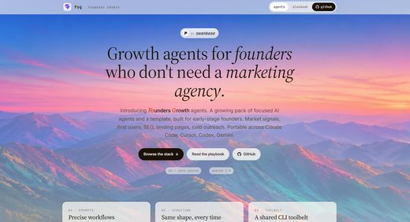</a> <a href="https://github.com/tns-research/fog-agents">tns-research/fog-agents</a></td>
</tr></table>

| Repo | Stars | What it does | Security |
|---|---:|---|---|
| [coreyhaines31/marketingskills](https://github.com/coreyhaines31/marketingskills) | 58.7k | Marketing skills for Claude Code and AI agents. CRO, copywriting, SEO, analytics, and growth engineering. | [SAFE](https://agentskillshub.top/skill/coreyhaines31/marketingskills/) |
| [irinabuht12-oss/marketing-skills](https://github.com/irinabuht12-oss/marketing-skills) | 6.9k | Claude skills for marketing: 49 free marketing skills for Claude Code and claude.ai (Google Ads, Meta Ads, SEO, AI visibility) + the Ryze Google Ads… | [SAFE](https://agentskillshub.top/skill/irinabuht12-oss/marketing-skills/) |
| [nowork-studio/notfair-plugin](https://github.com/nowork-studio/notfair-plugin) | 4.1k | Open-source SEO, GEO, and marketing skills for AI agents. | [SAFE](https://agentskillshub.top/skill/nowork-studio/notfair-plugin/) |
| [nowork-studio/notfair-plugin](https://github.com/nowork-studio/notfair-plugin) | 4.1k | Open-source SEO, GEO, and marketing skills for AI agents. | [SAFE](https://agentskillshub.top/skill/nowork-studio/notfair-plugin/) |
| [aaron-he-zhu/aaron-marketing-skills](https://github.com/aaron-he-zhu/aaron-marketing-skills) | 3.1k | 120 marketing skills as an AI marketing staff — plugin, portable skills, or an 8-bot team across 7 disciplines (narrative, SEO/GEO, social, email, pa… | [SAFE](https://agentskillshub.top/skill/aaron-he-zhu/aaron-marketing-skills/) |
| [zubair-trabzada/ai-marketing-claude](https://github.com/zubair-trabzada/ai-marketing-claude) | 2.9k | AI Marketing Suite for Claude Code. 15 marketing skills with parallel subagents — audit any website, generate copy, email sequences, ad campaigns, co… | [SAFE](https://agentskillshub.top/skill/zubair-trabzada/ai-marketing-claude/) |
| [tsingyuai/growth-lab](https://github.com/tsingyuai/growth-lab) | 2.0k | An end-to-end growth tool that understands the product, fetch the data it needs, researches the market, executes campaigns, and reviews results to im… | [SAFE](https://agentskillshub.top/skill/tsingyuai/growth-lab/) |
| [ReScienceLab/opc-skills](https://github.com/ReScienceLab/opc-skills) | 1.9k | Agent Skills for Solopreneurs | [SAFE](https://agentskillshub.top/skill/ReScienceLab/opc-skills/) |
| [gooseworks-ai/goose-skills](https://github.com/gooseworks-ai/goose-skills) | 1.3k | Library of Growth & GTM skills + data APIs for Claude Code, Codex, Cursor to run ads, social, content, lead gen, seo and data scraping | [SAFE](https://agentskillshub.top/skill/gooseworks-ai/goose-skills/) |
| [kostja94/marketing-skills](https://github.com/kostja94/marketing-skills) | 1.1k | Agent Skills for Marketing — SEO, Social, Influencer & More. 160+ open-source skills for SEO, content, 40+ page types, paid ads, channels, and strate… | [SAFE](https://agentskillshub.top/skill/kostja94/marketing-skills/) |
| [LeoYeAI/openclaw-marketing-skills](https://github.com/LeoYeAI/openclaw-marketing-skills) | 1.1k | 33 battle-tested marketing skills for OpenClaw agents — Powered by MyClaw.ai | [SAFE](https://agentskillshub.top/skill/LeoYeAI/openclaw-marketing-skills/) |
| [rampstackco/claude-skills](https://github.com/rampstackco/claude-skills) | 1.0k | Stack-agnostic Claude Skills covering the full website lifecycle: brand, design, content, SEO, dev, ops, growth, and research. Build, ship, audit, op… | [SAFE](https://agentskillshub.top/skill/rampstackco/claude-skills/) |
| [indranilbanerjee/digital-marketing-pro](https://github.com/indranilbanerjee/digital-marketing-pro) | 925 | An open-source AI based digital marketing operating system for strategy, SEO, AEO/GEO, paid media, content, CRM, and analytics - grounded in brand co… | [SAFE](https://agentskillshub.top/skill/indranilbanerjee/digital-marketing-pro/) |
| [OpenClaudia/openclaudia-skills](https://github.com/OpenClaudia/openclaudia-skills) | 730 | 77 open-source marketing skills for Claude Code, Codex, and other AI coding agents. SEO, content, email, ads, analytics, and growth. | [SAFE](https://agentskillshub.top/skill/OpenClaudia/openclaudia-skills/) |
| [Varnan-Tech/opendirectory](https://github.com/Varnan-Tech/opendirectory) | 693 | AI Agent Skills built for Founders who hate Marketing | [SAFE](https://agentskillshub.top/skill/Varnan-Tech/opendirectory/) |
| [unifapi-agent/agents](https://github.com/unifapi-agent/agents) | 610 | Open-source marketing agents for Claude, ChatGPT, Codex, OpenClaw & Hermes. One plugin: SEO audits, GEO / AI-visibility, local SEO, KOL pricing, soci… | [SAFE](https://agentskillshub.top/skill/unifapi-agent/agents/) |
| [davidpc007/openclaw-marketing-skills](https://github.com/davidpc007/openclaw-marketing-skills) | 176 | openclaw marketing skills which ships 38 agent skills covering CRO, copywriting, SEO, paid ads, growth, and GTM | [SAFE](https://agentskillshub.top/skill/davidpc007/openclaw-marketing-skills/) |
| [marcosmodly/marketing-skill](https://github.com/marcosmodly/marketing-skill) | 125 | Claude Code plugin with 14 composable marketing skills: competitor research, content calendars, SEO briefs, ad copy, cold outreach, short-form video… | [SAFE](https://agentskillshub.top/skill/marcosmodly/marketing-skill/) |
| [JasonColapietro/suede-creator-skills](https://github.com/JasonColapietro/suede-creator-skills) | 121 | Open-source skills for Claude Code and Codex, with an MCP server, a PyPI package and Suede Awesome Everything, a directory that scores AI agent skill… | [SAFE](https://agentskillshub.top/skill/JasonColapietro/suede-creator-skills/) |
| [kursku/skills](https://github.com/kursku/skills) | 116 | Catalogo com +2.300 skills para Claude AI — marketing, vendas, SEO, desenvolvimento e mais | [SAFE](https://agentskillshub.top/skill/kursku/skills/) |
| [cognyai/claude-code-marketing-skills](https://github.com/cognyai/claude-code-marketing-skills) | 114 | Marketing skills for Claude Code — SEO audits and implementation, ad analysis, ad optimization. Free skills need no account. $9/mo for live Search Co… | [SAFE](https://agentskillshub.top/skill/cognyai/claude-code-marketing-skills/) |
| [hyperfx-ai/marketing-skills](https://github.com/hyperfx-ai/marketing-skills) | 111 | Marketing skills for AI agents — paid ads, social media, SEO, competitor research, creative generation, email, analytics, and more. Powered by Hyper… | [SAFE](https://agentskillshub.top/skill/hyperfx-ai/marketing-skills/) |
| [ScaleBrick/founder-marketing-skills](https://github.com/ScaleBrick/founder-marketing-skills) | 90 | Open-source marketing skills for founders. Keyword research, growth strategy, social search audit, competitor analysis. Install with npx skills. | [SAFE](https://agentskillshub.top/skill/ScaleBrick/founder-marketing-skills/) |
| [adityaarsharma/youtube-marketing-skills](https://github.com/adityaarsharma/youtube-marketing-skills) | 78 | Open-source agent-agnostic YouTube growth toolkit — 21 AI commands + live channel MCP. Works with Claude Code, Cursor, Codex, Windsurf, Gemini CLI &… | [SAFE](https://agentskillshub.top/skill/adityaarsharma/youtube-marketing-skills/) |
| [LeadMagic/gtm-skills](https://github.com/LeadMagic/gtm-skills) | 74 | GTM agent skills for Claude Code, Codex, and GitHub Copilot: sales, marketing, SEO, RevOps, and customer research playbooks with templates. | [SAFE](https://agentskillshub.top/skill/LeadMagic/gtm-skills/) |
| [superamped/ai-marketing-skills](https://github.com/superamped/ai-marketing-skills) | 74 | Open-source AI marketing skills for coding agents like Claude Code, Cursor, and Codex. Do SEO, copywriting, competitor research, ad campaigns, market… | [SAFE](https://agentskillshub.top/skill/superamped/ai-marketing-skills/) |
| [cgallic/kai-cmo-harness](https://github.com/cgallic/kai-cmo-harness) | 64 | Open-source marketing harness for Claude Code and Codex: skills for SEO, content, email, ads, launches, CRO and AI-search visibility. Run as a servic… | [SAFE](https://agentskillshub.top/skill/cgallic/kai-cmo-harness/) |
| [AgriciDaniel/marketing-skill-pack](https://github.com/AgriciDaniel/marketing-skill-pack) | 53 | One-command installer for all AI Marketing Hub tools: Claude SEO, Claude Blog, Skill Forge, WP MCP Ultimate | [SAFE](https://agentskillshub.top/skill/AgriciDaniel/marketing-skill-pack/) |
| [smithjohn78390/smith--skills](https://github.com/smithjohn78390/smith--skills) | 49 | 自用/精选的 Claude Code / Codex 技能：内容创作、客服、市场调研、SEO、Agent 工作流循环、Grok X 实时抓取与评审工具 | [SAFE](https://agentskillshub.top/skill/smithjohn78390/smith--skills/) |
| [rediumvex/ai-marketing-claude](https://github.com/rediumvex/ai-marketing-claude) | 40 | Marketing operations toolkit for Claude Code — 12 skills, 5 specialist subagents, and Python scripts for audits, CRO, SEO, copy, emails, ads, and cli… | [SAFE](https://agentskillshub.top/skill/rediumvex/ai-marketing-claude/) |
| [shalintripathi/saas-marketing-agents](https://github.com/shalintripathi/saas-marketing-agents) | 33 | AI marketing agents for Claude Code: a B2B SaaS marketing team as a plugin. 92 agents in 17 disciplines, CATALYST orchestrator, 19 skills and a Campa… | [SAFE](https://agentskillshub.top/skill/shalintripathi/saas-marketing-agents/) |
| [Gingiris/gingiris-skills](https://github.com/Gingiris/gingiris-skills) | 24 | 🌱 Gingiris Growth Skills for Claude Code — SEO/GEO patrol, Jekyll blog publishing, Product Hunt launch playbook. Install via plugin marketplace. | [SAFE](https://agentskillshub.top/skill/Gingiris/gingiris-skills/) |
| [ekinciio/saas-growth-marketing-skills](https://github.com/ekinciio/saas-growth-marketing-skills) | 15 | Claude Code skills collection for SaaS growth marketing - 15 skills covering ASO, GEO/SEO, CRO, PLG funnels, retention, pricing, competitor intel, an… | [SAFE](https://agentskillshub.top/skill/ekinciio/saas-growth-marketing-skills/) |
| [LuCheremisina/marketing-skills](https://github.com/LuCheremisina/marketing-skills) | 11 | AI marketing skills for research, SEO/GEO, Yandex advertising analytics and expert content. 27 marketing workflows + 14 optional engineering skills. | [SAFE](https://agentskillshub.top/skill/LuCheremisina/marketing-skills/) |
| [twominutereports/marketing-skills](https://github.com/twominutereports/marketing-skills) | 10 | Claude Marketing Skills for SEO, PPC, and ecommerce reporting, analysis, and automation via MCP. | [SAFE](https://agentskillshub.top/skill/twominutereports/marketing-skills/) |
| [rdoser13/free-claude-skills](https://github.com/rdoser13/free-claude-skills) | 9 | 15 free Claude marketing skills for Claude Code. SEO, keyword research, CRO, content strategy, landing pages, short-form video, and anti-slop quality… | [SAFE](https://agentskillshub.top/skill/rdoser13/free-claude-skills/) |
| [unempyd/revenueos](https://github.com/unempyd/revenueos) | 8 | Connect your business. RevenueOS finds opportunities, executes approved revenue work, and measures what happened. Self-hosted, MIT. | [SAFE](https://agentskillshub.top/skill/unempyd/revenueos/) |
| [tns-research/fog-agents](https://github.com/tns-research/fog-agents) | 6 | Portable AI agents for early-stage founders. Market signal, first users, SEO, landing page, cold outreach. Works with Claude Code, Cursor, Codex CLI,… | [SAFE](https://agentskillshub.top/skill/tns-research/fog-agents/) |
| [ranjeeetvimal/growth-skills](https://github.com/ranjeeetvimal/growth-skills) | 5 | Open-source agent skills for founder-led growth — PLG strategy, SEO, and X/social-media growth. Works in Claude Code, Cursor, Gemini CLI & any Agent… | [SAFE](https://agentskillshub.top/skill/ranjeeetvimal/growth-skills/) |

**Security** is the grade of the repo's README and install steps on Agent Skills Hub. *pending* means the catalog has not graded it yet.

Preview images are reduced copies of pictures from each project's own README, included only for projects under a permissive license. Sources and licenses: [assets/previews/NOTICE.md](assets/previews/NOTICE.md). Open an issue to have one removed.

## Related collections

- [zhuyansen/awesome-claude-video-skills](https://github.com/zhuyansen/awesome-claude-video-skills), [zhuyansen/awesome-codex-ppt-skills](https://github.com/zhuyansen/awesome-codex-ppt-skills) — lists built the same way.

## Add a repo

Open an issue with the GitHub URL. It goes through the same review as every entry; the rules above decide, stars do not.

---

Machine-readable copy: [`data/skills.json`](data/skills.json). Generated 2026-11-05.
