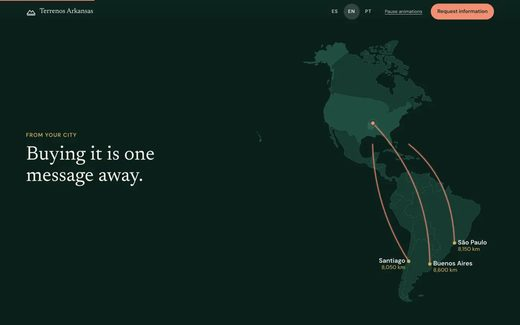
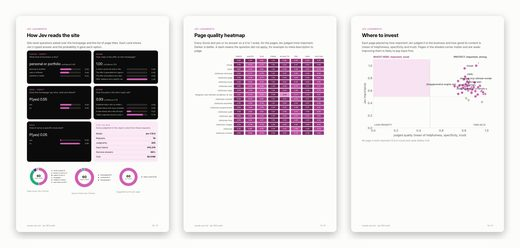
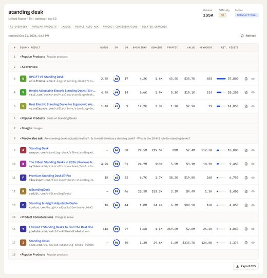
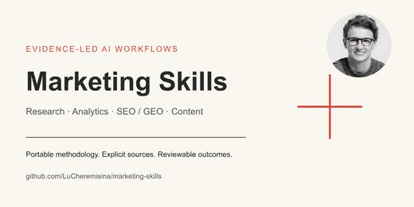

# Awesome Claude SEO Skills

[English](README.md)

给 Claude Code、Codex 等 agent 用的开源 **Claude SEO skill、SEO MCP 服务和 GEO 工具**:综合 SEO skill、审计、关键词研究、Search Console 与 SEO 数据 MCP、AI 搜索可见性、内容写作和外链建设。共 259 个仓库,每个都由 [Agent Skills Hub (agentskillshub.top)](https://agentskillshub.top?utm_source=github&utm_medium=awesome-list) 读过 README 并做了安全评级。

带类型筛选的在线页面:**[https://agentskillshub.top/best/seo-tools/](https://agentskillshub.top/best/seo-tools/?utm_source=github&utm_medium=awesome-list)** · 每 8 小时刷新

## 这些工具长什么样

<table>
<tr>
<td align="center" valign="top" width="33%"><b>🧰 综合 SEO Skill</b> 71 个仓库   一个 skill 或 agent 包办审计、关键词、内容和技术检查。 <a href="#type-suite"><b>查看列表 →</b></a></td>
<td align="center" valign="top" width="33%"><b>🩺 站点与页面审计</b> 33 个仓库   抓取站点或读取页面,列出要修的问题。 <a href="#type-audit"><b>查看列表 →</b></a></td>
<td align="center" valign="top" width="33%"><b>🔎 关键词与排名研究</b> 11 个仓库   找词、估算搜索需求、跟踪排名。 <a href="#type-research"><b>查看列表 →</b></a></td>
</tr>
<tr>
<td align="center" valign="top" width="33%"><b>🔌 SEO 数据 MCP 与监控面板</b> 31 个仓库   把 Search Console、抓取和 SEO 数据库的数据交给 agent,以及自托管面板。 <a href="#type-data_mcp"><b>查看列表 →</b></a></td>
<td align="center" valign="top" width="33%"><b>🤖 GEO 与 AI 搜索可见性</b> 49 个仓库   在 AI 回答里的可见性:GEO、AEO、引用追踪。 <a href="#type-geo"><b>查看列表 →</b></a></td>
<td align="center" valign="top" width="33%"><b>✍️ SEO 内容写作</b> 22 个仓库  为排名而写的文章、大纲和页面文案。 <a href="#type-content"><b>查看列表 →</b></a></td>
</tr>
<tr>
<td align="center" valign="top" width="33%"><b>🔗 外链建设与外链审计</b> 5 个仓库  外链与媒体机会、目录提交,以及外链来源检查。 <a href="#type-links"><b>查看列表 →</b></a></td>
<td align="center" valign="top" width="33%"><b>📣 含 SEO 的营销合集</b> 37 个仓库   SEO 只是其中一部分的综合营销合集。 <a href="#type-marketing"><b>查看列表 →</b></a></td>
</tr>
</table>

## 目录

- [🧰 综合 SEO Skill](#type-suite) (71)
- [🩺 站点与页面审计](#type-audit) (33)
- [🔎 关键词与排名研究](#type-research) (11)
- [🔌 SEO 数据 MCP 与监控面板](#type-data_mcp) (31)
- [🤖 GEO 与 AI 搜索可见性](#type-geo) (49)
- [✍️ SEO 内容写作](#type-content) (22)
- [🔗 外链建设与外链审计](#type-links) (5)
- [📣 含 SEO 的营销合集](#type-marketing) (37)

## 什么样的仓库能上榜

1. 用 agent 做 SEO,或让站点在 AI 回答里被找到、被引用,是它的主要用途。只是对 SEO 友好的站点模板、没有 agent 接口的 SEO 产品、改了名的别人的仓库不算。
2. 它是能安装或运行的软件,不是链接合集或空仓库。
3. 它有 README。没有 README 就没法评级。
4. 50 星及以上只看是否切题;50 星以下还要过 README 质量线(展示效果、一条命令上手、说清产出、文档完整),并且至少 5 星。

这些问题由决策模型逐个读 README 回答,不是人工挑选。卡在线上的仓库可能判到任一边,归错了请提 issue。

## 🧰 综合 SEO Skill

[在在线页面打开这一类,按星数排序 →](https://agentskillshub.top/best/seo-tools/?utm_source=github&utm_medium=awesome-list#type-suite)

| 仓库 | 星数 | 做什么 | 安全评级 |
|---|---:|---|---|
| [AgriciDaniel/claude-seo](https://github.com/AgriciDaniel/claude-seo) | 24.3k | Claude Code 的通用 SEO 技能，包含技术 SEO、E-E-A-T、schema、GEO/AEO、代理准备、外链、本地 SEO、电商、国际 SEO… | [SAFE](https://agentskillshub.top/skill/AgriciDaniel/claude-seo/?utm_source=github&utm_medium=awesome-list) |
| [Ryze-AI-Adgent/open-seo-mcp-skills](https://github.com/Ryze-AI-Adgent/open-seo-mcp-skills) | 8.1k | 开源 SEO MCP server 与 SEO、GEO skills，支持 Claude 进行关键词研究、排名跟踪、审计、反向链接及基于真实 GSC/GA4/… | [SAFE](https://agentskillshub.top/skill/Ryze-AI-Adgent/open-seo-mcp-skills/?utm_source=github&utm_medium=awesome-list) |
| [AgriciDaniel/claude-blog](https://github.com/AgriciDaniel/claude-blog) | 2.6k | Claude Code 博客技能套件：30 子技能，5 个 agent，5-gate v1.9.0，支持谷歌排名和 AI 引用，持续开发中。 | [SAFE](https://agentskillshub.top/skill/AgriciDaniel/claude-blog/?utm_source=github&utm_medium=awesome-list) |
| [leopard627/fire-your-seo-agency](https://github.com/leopard627/fire-your-seo-agency) | 986 | 自动审核优化SEO·AEO·GEO·LLMO·NEO的Claude Code技能，替代人工代理 | [SAFE](https://agentskillshub.top/skill/leopard627/fire-your-seo-agency/?utm_source=github&utm_medium=awesome-list) |
| [AgriciDaniel/chatgpt-seo](https://github.com/AgriciDaniel/chatgpt-seo) | 894 | 将页面、草稿或 SEO 导出内容转为 ChatGPT 中的有来源修复计划。 | [SAFE](https://agentskillshub.top/skill/AgriciDaniel/chatgpt-seo/?utm_source=github&utm_medium=awesome-list) |
| [Illyism/seo-skills](https://github.com/Illyism/seo-skills) | 685 | Claude Code、Cursor 和 Codex 的 SEO skill：自动化、标题标签、博客更新、反向链接、客户旅程、视频转录和文案。 | [SAFE](https://agentskillshub.top/skill/Illyism/seo-skills/?utm_source=github&utm_medium=awesome-list) |
| [joeseesun/qiaomu-seo](https://github.com/joeseesun/qiaomu-seo) | 466 | 审计、诊断、研究、规划、实施、实验和验证网站在Google、Bing及AI搜索的SEO技术。 | [SAFE](https://agentskillshub.top/skill/joeseesun/qiaomu-seo/?utm_source=github&utm_medium=awesome-list) |
| [ViryaZheng/recomby-geo](https://github.com/ViryaZheng/recomby-geo) | 457 | GEO 领域 AI 员工开源方案，包含 GEO Skills 包和精选 agent 及办公 CLI 列表。 | [SAFE](https://agentskillshub.top/skill/ViryaZheng/recomby-geo/?utm_source=github&utm_medium=awesome-list) |
| [inhouseseo/superseo-skills](https://github.com/inhouseseo/superseo-skills) | 375 | 11 个 SEO Claude skill：页面、链接、文章、E-E-A-T、语义差距审计；方法来自 Koray Tuğberk、Kyle Roof、Lily… | [SAFE](https://agentskillshub.top/skill/inhouseseo/superseo-skills/?utm_source=github&utm_medium=awesome-list) |
| [mars-tw/open-seo-advisor-skill](https://github.com/mars-tw/open-seo-advisor-skill) | 351 | 开源可携带的全域 SEO 顾问技能，支持多行业 SEO 检查修复与内容产出 | [SAFE](https://agentskillshub.top/skill/mars-tw/open-seo-advisor-skill/?utm_source=github&utm_medium=awesome-list) |
| [aaron-he-zhu/seo-geo-claude-skills](https://github.com/aaron-he-zhu/seo-geo-claude-skills) | 231 | Signpost 包含16个SEO/GEO agent技能，aaron-marketing-skills仓库；本仓库保留20技能版本v9.9.12。安装：np… | [SAFE](https://agentskillshub.top/skill/aaron-he-zhu/seo-geo-claude-skills/?utm_source=github&utm_medium=awesome-list) |
| [beyondtahir/beyondseo](https://github.com/beyondtahir/beyondseo) | 230 | 完整SEO工具：原生爬虫、SEO/AEO/GEO、内容、竞品和声誉，含206发布源和定制反链方案，无需API密钥。 | [SAFE](https://agentskillshub.top/skill/beyondtahir/beyondseo/?utm_source=github&utm_medium=awesome-list) |
| [yan-labs/yan-skills](https://github.com/yan-labs/yan-skills) | 227 | Yan 的 agent skills 集合——Google Trends SEO 工作流、AI 新闻、autopilot 等，适用于 Claude Code… | [SAFE](https://agentskillshub.top/skill/yan-labs/yan-skills/?utm_source=github&utm_medium=awesome-list) |
| [Bomx/distribb-skill](https://github.com/Bomx/distribb-skill) | 202 | Distribb CLI、Claude、Codex、Hermes、OpenClaw 技能支持 AI 驱动的 SEO，使用 AI 写作并通过 Distribb… | [SAFE](https://agentskillshub.top/skill/Bomx/distribb-skill/?utm_source=github&utm_medium=awesome-list) |
| [seranking/seo-skills](https://github.com/seranking/seo-skills) | 191 | Claude SEO Skills：用于 SE Ranking MCP server，涵盖内容简报、审计、关键词集群和 GEO。 | [SAFE](https://agentskillshub.top/skill/seranking/seo-skills/?utm_source=github&utm_medium=awesome-list) |
| [akseolabs-seo/seo-coach](https://github.com/akseolabs-seo/seo-coach) | 189 | AK设计的免费开源AI SEO陪跑教练，适合SEO新手和小品牌网站 | [SAFE](https://agentskillshub.top/skill/akseolabs-seo/seo-coach/?utm_source=github&utm_medium=awesome-list) |
| [zubair-trabzada/dataforseo-claude](https://github.com/zubair-trabzada/dataforseo-claude) | 174 | Claude Code 的 SEO 工具，基于 DataForSEO。13 个 skill、5 个 subagent，支持关键词、排名、反向链接、技术爬取、竞… | [SAFE](https://agentskillshub.top/skill/zubair-trabzada/dataforseo-claude/?utm_source=github&utm_medium=awesome-list) |
| [yaojingang/GEOHub](https://github.com/yaojingang/GEOHub) | 167 | GEOHub：基于证据的GEO和SEO智能体技能，支持发现、诊断、内容、测量和SEO规划。 | [SAFE](https://agentskillshub.top/skill/yaojingang/GEOHub/?utm_source=github&utm_medium=awesome-list) |
| [AgriciDaniel/seo-os](https://github.com/AgriciDaniel/seo-os) | 147 | SEO Office 是一个本地优先的 SEO 代理操作系统，包含 claw3d UI、claude-seo 专家和营销策略，作为私有仓库分发给非技术社区。 | [SAFE](https://agentskillshub.top/skill/AgriciDaniel/seo-os/?utm_source=github&utm_medium=awesome-list) |
| [deepakness/google-ai-search-optimization](https://github.com/deepakness/google-ai-search-optimization) | 141 | 基于 Google 搜索指导的非官方 Agent Skill，用于 AI 概览、AI 模式和 SEO 审计。 | [SAFE](https://agentskillshub.top/skill/deepakness/google-ai-search-optimization/?utm_source=github&utm_medium=awesome-list) |
| [garrettjsmith/localseoskills](https://github.com/garrettjsmith/localseoskills) | 140 | 开源 Claude 本地 SEO 工具，提供 skills、工具集成和自动化模板 | [SAFE](https://agentskillshub.top/skill/garrettjsmith/localseoskills/?utm_source=github&utm_medium=awesome-list) |
| [Houseofmvps/ultraship](https://github.com/Houseofmvps/ultraship) | 123 | ULTRASHIP Claude Code插件：39skill、33工具、11agent，涵盖安全、监控、SEO/AI检查和事件响应；1依赖、180测试、MIT | [SAFE](https://agentskillshub.top/skill/Houseofmvps/ultraship/?utm_source=github&utm_medium=awesome-list) |
| [AKCodez/seo-god](https://github.com/AKCodez/seo-god) | 118 | 将 Claude Code 变成你网站的 SEO 代理，支持审计、测量、日常循环和定时运行，无需付费密钥。 | [SAFE](https://agentskillshub.top/skill/AKCodez/seo-god/?utm_source=github&utm_medium=awesome-list) |
| [huifer/claude-code-seo](https://github.com/huifer/claude-code-seo) | 111 | Next.js SEO 助手插件，自动化 SEO 审核，涵盖元数据、结构化数据、E-E-A-T、内容策略、本地 SEO 和外链建设，支持双语优化和智能路由检测。 | [SAFE](https://agentskillshub.top/skill/huifer/claude-code-seo/?utm_source=github&utm_medium=awesome-list) |
| [jdevalk/skills](https://github.com/jdevalk/skills) | 109 | Claude Code 的 GitHub 仓库和个人资料、WordPress 与 EmDash 插件、Astro SEO 及内容可读性 skills | [SAFE](https://agentskillshub.top/skill/jdevalk/skills/?utm_source=github&utm_medium=awesome-list) |
| [zhtyyx/codex-seo](https://github.com/zhtyyx/codex-seo) | 108 | OpenAI Codex CLI开源免费SEO审计，移植claude-seo：26个skill、19类专职角色；技术SEO/schema/GEO/本地/电商 | [SAFE](https://agentskillshub.top/skill/zhtyyx/codex-seo/?utm_source=github&utm_medium=awesome-list) |
| [IamRamgarhia/All-In-One-Free-SEO-Tool](https://github.com/IamRamgarhia/All-In-One-Free-SEO-Tool) | 102 | 开源自托管 SEO 工具；99 项工具涵盖审计、排名、关键词、AI 搜索、内容、反链、本地 SEO、白标报告及修复 agent；无需付费 API，MIT。 | [SAFE](https://agentskillshub.top/skill/IamRamgarhia/All-In-One-Free-SEO-Tool/?utm_source=github&utm_medium=awesome-list) |
| [TheMattBerman/seo-kit](https://github.com/TheMattBerman/seo-kit) | 100 | AI agent 识别关键词、撰写内容、监控排名并自我优化，包含两个 OpenClaw 技能形成复合 SEO 循环。 | [SAFE](https://agentskillshub.top/skill/TheMattBerman/seo-kit/?utm_source=github&utm_medium=awesome-list) |
| [mykpono/ultimate-seo-geo](https://github.com/mykpono/ultimate-seo-geo) | 95 | Claude 的 SEO + GEO 技能，包含站点审核、AI 搜索优化、schema 生成、E-E-A-T 评估和诊断脚本，支持审核、规划和执行三种模式。 | [SAFE](https://agentskillshub.top/skill/mykpono/ultimate-seo-geo/?utm_source=github&utm_medium=awesome-list) |
| [flaqai/Awesome_SEO_Writing_Skill](https://github.com/flaqai/Awesome_SEO_Writing_Skill) | 91 | 分享由Flaq AI团队开发的SEO写作技能合集 | [SAFE](https://agentskillshub.top/skill/flaqai/Awesome_SEO_Writing_Skill/?utm_source=github&utm_medium=awesome-list) |
| [nikhilbhansali/dataforseo-skill-claude](https://github.com/nikhilbhansali/dataforseo-skill-claude) | 68 | Claude Code 的 DataForSEO API 技能，完整的 SEO 数据集成 | [SAFE](https://agentskillshub.top/skill/nikhilbhansali/dataforseo-skill-claude/?utm_source=github&utm_medium=awesome-list) |
| [norahe0304-art/30x-seo](https://github.com/norahe0304-art/30x-seo) | 57 | 23个适用于Claude Code的生产级SEO技能，包括技术SEO、内容优化、关键词研究、反向链接分析和AI可见性监控。 | [SAFE](https://agentskillshub.top/skill/norahe0304-art/30x-seo/?utm_source=github&utm_medium=awesome-list) |
| [dannwaneri/seo-agent](https://github.com/dannwaneri/seo-agent) | 55 | 开源SEO审计代理，支持真实浏览器检测、反向链接评分和多引擎AI引用跟踪（Claude、ChatGPT等） | [SAFE](https://agentskillshub.top/skill/dannwaneri/seo-agent/?utm_source=github&utm_medium=awesome-list) |
| [southwellmedia/seo-audit](https://github.com/southwellmedia/seo-audit) | 53 | Claude Skill 用于 SEO 审核和 PDF 导出 | [SAFE](https://agentskillshub.top/skill/southwellmedia/seo-audit/?utm_source=github&utm_medium=awesome-list) |
| [XuanRanL/loamwright-SEO-Skill](https://github.com/XuanRanL/loamwright-SEO-Skill) | 52 | 面向Claude Code的生产级SEO和地理内容工厂，支持研究、写作、校对、优化、发布和监控。 | [SAFE](https://agentskillshub.top/skill/XuanRanL/loamwright-SEO-Skill/?utm_source=github&utm_medium=awesome-list) |
| [agencia-conversion/agentic-seo-skills](https://github.com/agencia-conversion/agentic-seo-skills) | 51 | Claude Code 插件形式的 Agentic SEO 操作系统：项目 Wiki、DataForSEO 工作流、内容简报、技术 SEO 和人工审批关卡。 | [SAFE](https://agentskillshub.top/skill/agencia-conversion/agentic-seo-skills/?utm_source=github&utm_medium=awesome-list) |
| [199-biotechnologies/claude-skill-seo-geo-optimizer](https://github.com/199-biotechnologies/claude-skill-seo-geo-optimizer) | 50 | 适用于SEO/GEO优化的Claude skill，支持内容分析、实体提取、schema生成和多格式审计报告。 | [SAFE](https://agentskillshub.top/skill/199-biotechnologies/claude-skill-seo-geo-optimizer/?utm_source=github&utm_medium=awesome-list) |
| [sergekostenchuk/seo-llm-skill-cluster](https://github.com/sergekostenchuk/seo-llm-skill-cluster) | 40 | 基于任务计划的SEO和LLM友好型网站技能集群 | [SAFE](https://agentskillshub.top/skill/sergekostenchuk/seo-llm-skill-cluster/?utm_source=github&utm_medium=awesome-list) |
| [mangollc/claude-seo-skill](https://github.com/mangollc/claude-seo-skill) | 39 | 面向机构的Claude Code SEO与AEO插件，支持关键词研究、技术审计、内容优化、本地SEO、外链和AI搜索优化。 | [SAFE](https://agentskillshub.top/skill/mangollc/claude-seo-skill/?utm_source=github&utm_medium=awesome-list) |
| [NicoSKOOL/the-four-systems](https://github.com/NicoSKOOL/the-four-systems) | 38 | 四个由 Claude Code 触发的 SEO 技能，共享仪表盘更新，支持定时自动运行。 | [SAFE](https://agentskillshub.top/skill/NicoSKOOL/the-four-systems/?utm_source=github&utm_medium=awesome-list) |
| [MariusYvard/NullToHero](https://github.com/MariusYvard/NullToHero) | 30 | 适用于Claude Code、Codex、Kimi和Hermes的便携式Agent技能工具包，包含网页设计、SEO/GEO、审计和确定性移动验证。 | [SAFE](https://agentskillshub.top/skill/MariusYvard/NullToHero/?utm_source=github&utm_medium=awesome-list) |
| [ziniman/ai-instruct](https://github.com/ziniman/ai-instruct) | 29 | 将 AI 助手转为高级网页开发者，提供 SEO、性能和 agent 准备指南，适用于 Claude Code、Cursor、Copilot 和 Windsur… | [SAFE](https://agentskillshub.top/skill/ziniman/ai-instruct/?utm_source=github&utm_medium=awesome-list) |
| [bonnie-ship-it/AgriciDaniel-claude-seo](https://github.com/bonnie-ship-it/AgriciDaniel-claude-seo) | 23 | Claude SEO 是 Claude Code 的综合 SEO 分析技能，涵盖技术 SEO、页面分析、内容质量、结构化数据、图片优化、网站地图架构、AI 搜… | [CAUTION](https://agentskillshub.top/skill/bonnie-ship-it/AgriciDaniel-claude-seo/?utm_source=github&utm_medium=awesome-list) |
| [lionkiii/claude-seo-skills](https://github.com/lionkiii/claude-seo-skills) | 22 | 42条Claude Code SEO命令，涵盖站点审计、Ahrefs反链、GSC分析、SERP研究、内容概要、技术SEO和schema验证等 | [SAFE](https://agentskillshub.top/skill/lionkiii/claude-seo-skills/?utm_source=github&utm_medium=awesome-list) |
| [calm-north/seojuice-skills](https://github.com/calm-north/seojuice-skills) | 21 | 在 Claude、Codex 等中运行的深度 SEO 技能 | [SAFE](https://agentskillshub.top/skill/calm-north/seojuice-skills/?utm_source=github&utm_medium=awesome-list) |
| [lhitches/claude-seo-skills](https://github.com/lhitches/claude-seo-skills) | 21 | 29个免费Claude Skills用于SEO和AI搜索，适用于Claude Desktop。 | [SAFE](https://agentskillshub.top/skill/lhitches/claude-seo-skills/?utm_source=github&utm_medium=awesome-list) |
| [thebigasif/google-leak-patents-seo](https://github.com/thebigasif/google-leak-patents-seo) | 21 | 2024年Google内容仓库API泄露，关联5456个搜索专利，包含848个排名信号和77663条专利权利要求，12阶段流程和26个决策手册，可作为Clau… | [SAFE](https://agentskillshub.top/skill/thebigasif/google-leak-patents-seo/?utm_source=github&utm_medium=awesome-list) |
| [seoskillsai/seo-skills-ai](https://github.com/seoskillsai/seo-skills-ai) | 20 | SEO Skills AI：基于Claude Code等的通用AI SEO代理和技术优化套件 | [SAFE](https://agentskillshub.top/skill/seoskillsai/seo-skills-ai/?utm_source=github&utm_medium=awesome-list) |
| [deeployCO/youtube-seo-skills](https://github.com/deeployCO/youtube-seo-skills) | 18 | Claude Code 的高级 YouTube SEO 技能套件，含审计、优化、关键词、缩略图和竞品分析脚本。 | [SAFE](https://agentskillshub.top/skill/deeployCO/youtube-seo-skills/?utm_source=github&utm_medium=awesome-list) |
| [mlsss333/seo-geo-kit](https://github.com/mlsss333/seo-geo-kit) | 15 | Skill Claude：网站 SEO + GEO 审计、自动应用修复，并撰写适配 Google 和 AI 的文章 | [SAFE](https://agentskillshub.top/skill/mlsss333/seo-geo-kit/?utm_source=github&utm_medium=awesome-list) |
| [lynnzc/loki-yan-seo-skill](https://github.com/lynnzc/loki-yan-seo-skill) | 13 | Loki Yan (@loki_yan_seo) 公开推文的非官方 Agent Skill，谷歌 SEO/AIO/GEO 诊断引擎。 | [SAFE](https://agentskillshub.top/skill/lynnzc/loki-yan-seo-skill/?utm_source=github&utm_medium=awesome-list) |
| [searchfit/searchfit-seo](https://github.com/searchfit/searchfit-seo) | 13 | 基于AI的Claude Code SEO工具，网站审计、内容规划、页面优化和可见性跟踪 | [SAFE](https://agentskillshub.top/skill/searchfit/searchfit-seo/?utm_source=github&utm_medium=awesome-list) |
| [jrr996shujin-png/openclaw-seo-aeo-skills](https://github.com/jrr996shujin-png/openclaw-seo-aeo-skills) | 12 | OpenClaw 的 SEO 和 AEO 技能包，诊断网站健康，挖掘长尾问题，跟踪关键词排名和竞品内容，生成月度报告。 | [SAFE](https://agentskillshub.top/skill/jrr996shujin-png/openclaw-seo-aeo-skills/?utm_source=github&utm_medium=awesome-list) |
| [ApollosWave/gsc-cli](https://github.com/ApollosWave/gsc-cli) | 11 | Google Search Console 官方技术 SEO 引擎，用纯 Ruby、零依赖自动化 Googlebot 索引、审计 Core Web Vital… | [SAFE](https://agentskillshub.top/skill/ApollosWave/gsc-cli/?utm_source=github&utm_medium=awesome-list) |
| [kabde/seo-skills](https://github.com/kabde/seo-skills) | 11 | SEO Blogger Toolkit for Claude Code 包含15个WordPress技能：审计、写作、发布、主题集群、E-E-A-T、sche… | [SAFE](https://agentskillshub.top/skill/kabde/seo-skills/?utm_source=github&utm_medium=awesome-list) |
| [saadsalmankhan/entity-seo-skill](https://github.com/saadsalmankhan/entity-seo-skill) | 11 | 为个人或品牌名排名第一的 Claude skill 和操作手册，包含站内 SEO、JSON-LD 实体图、站外权威及免费 GSC 排名自动化，MIT 许可。 | [SAFE](https://agentskillshub.top/skill/saadsalmankhan/entity-seo-skill/?utm_source=github&utm_medium=awesome-list) |
| [s87343472/one-page-one-keyword](https://github.com/s87343472/one-page-one-keyword) | 10 | Claude 的 SEO 关键词布局优化技能 | [SAFE](https://agentskillshub.top/skill/s87343472/one-page-one-keyword/?utm_source=github&utm_medium=awesome-list) |
| [NicoSKOOL/ai-ranking-scroll-seo](https://github.com/NicoSKOOL/ai-ranking-scroll-seo) | 8 | Claude Code skill：兼顾搜索排名的滚动驱动网站，使用 WebP、Schema、关键词匹配的 H1、Lighthouse 和 agentic b… | [SAFE](https://agentskillshub.top/skill/NicoSKOOL/ai-ranking-scroll-seo/?utm_source=github&utm_medium=awesome-list) |
| [kevinwowo/waimao-seo-audit](https://github.com/kevinwowo/waimao-seo-audit) | 8 | 外贸独立站 SEO 审计，含整站审计、关键词聚类、Fan-Out 覆盖度和白标 HTML 报告及 Excel，支持 Claude Code 插件。 | [SAFE](https://agentskillshub.top/skill/kevinwowo/waimao-seo-audit/?utm_source=github&utm_medium=awesome-list) |
| [sunlin-xiaonai/web-cafe-seo-agent-skill](https://github.com/sunlin-xiaonai/web-cafe-seo-agent-skill) | 8 | 使用 Codex 的 Web.Cafe SEO Agent，支持隐藏浏览器执行和聊天内结果。 | [SAFE](https://agentskillshub.top/skill/sunlin-xiaonai/web-cafe-seo-agent-skill/?utm_source=github&utm_medium=awesome-list) |
| [ouranos-labs/pseolint](https://github.com/ouranos-labs/pseolint) | 7 | 发布前防护pSEO垃圾邮件，审计页面关系，AI筛查，支持8个LLM，含本地遥测和成本限制，MCP服务器。 | [SAFE](https://agentskillshub.top/skill/ouranos-labs/pseolint/?utm_source=github&utm_medium=awesome-list) |
| [shalintripathi/organic-os](https://github.com/shalintripathi/organic-os) | 7 | 使用 Claude 在自己网站上运行持续的 SEO/AEO 增长循环，提取 GA4 和 Search Console 数据，提出并应用经批准的修复，验证效果并… | [SAFE](https://agentskillshub.top/skill/shalintripathi/organic-os/?utm_source=github&utm_medium=awesome-list) |
| [AndreasH96/seo-geo-consultant](https://github.com/AndreasH96/seo-geo-consultant) | 6 | Claude Code 插件：高级 SEO 和 GEO 顾问，负责技术 SEO、结构化数据和 AI 搜索可见性审核与实施。 | [SAFE](https://agentskillshub.top/skill/AndreasH96/seo-geo-consultant/?utm_source=github&utm_medium=awesome-list) |
| [CrazySwami/wordpress-dev-skills](https://github.com/CrazySwami/wordpress-dev-skills) | 6 | Claude Code 的完整 WordPress 开发与自动化工具包，包含 Docker、Playground、白标、SEO、视觉质量检测和性能优化技能 | [SAFE](https://agentskillshub.top/skill/CrazySwami/wordpress-dev-skills/?utm_source=github&utm_medium=awesome-list) |
| [affilino/ecommerce-seo-audit-skill](https://github.com/affilino/ecommerce-seo-audit-skill) | 6 | 电商SEO审计技能，提供产品页、分类页、技术SEO、日志分析和竞品调研等全面审计，支持Claude Code等AI编码助手。 | [SAFE](https://agentskillshub.top/skill/affilino/ecommerce-seo-audit-skill/?utm_source=github&utm_medium=awesome-list) |
| [nexscope-ai/ecommerce-seo-geo-skills](https://github.com/nexscope-ai/ecommerce-seo-geo-skills) | 6 | 电商SEO、地理定位、结构化数据、产品列表优化、关键词差距和买家意图内容的通用技能。 | [SAFE](https://agentskillshub.top/skill/nexscope-ai/ecommerce-seo-geo-skills/?utm_source=github&utm_medium=awesome-list) |
| [venomous2/opencode-seo](https://github.com/venomous2/opencode-seo) | 6 | OpenCode 的 AI 原生 SEO 平台，包含规则引擎、SEO 代码检查、修复引擎、引用评分、漂移监控和图表报告。 | [SAFE](https://agentskillshub.top/skill/venomous2/opencode-seo/?utm_source=github&utm_medium=awesome-list) |
| [oegeyilmaz9/seo-aeo-geo-ultimate](https://github.com/oegeyilmaz9/seo-aeo-geo-ultimate) | 5 | 以证据为先的 SEO、AEO、GEO 和 AI 搜索工作流，适用于 Codex 和 Claude Code，一个路由器，27 个 skill。 | [SAFE](https://agentskillshub.top/skill/oegeyilmaz9/seo-aeo-geo-ultimate/?utm_source=github&utm_medium=awesome-list) |
| [owensky-dev/seo-gsc-ga4-analyst](https://github.com/owensky-dev/seo-gsc-ga4-analyst) | 5 | 使用 Google Search Console 和 GA4 数据进行本地 SEO 分析的 Codex skill | [SAFE](https://agentskillshub.top/skill/owensky-dev/seo-gsc-ga4-analyst/?utm_source=github&utm_medium=awesome-list) |
| [rankmyseo/skills](https://github.com/rankmyseo/skills) | 5 | 用于 SEO 的 agent skill：借助 RankMySEO、Search Console 和 GA4 规划、构建、发布和维护网站。草稿。 | [SAFE](https://agentskillshub.top/skill/rankmyseo/skills/?utm_source=github&utm_medium=awesome-list) |
| [rocketmandrey/seo-standup](https://github.com/rocketmandrey/seo-standup) | 5 | SEO skill：用于 AI agent，15 分钟站会，讲解如何根据现有需求设计网站。不使用付费 API。 | [SAFE](https://agentskillshub.top/skill/rocketmandrey/seo-standup/?utm_source=github&utm_medium=awesome-list) |

## 🩺 站点与页面审计

[在在线页面打开这一类,按星数排序 →](https://agentskillshub.top/best/seo-tools/?utm_source=github&utm_medium=awesome-list#type-audit)

| 仓库 | 星数 | 做什么 | 安全评级 |
|---|---:|---|---|
| [Bhanunamikaze/Agentic-SEO-Skill](https://github.com/Bhanunamikaze/Agentic-SEO-Skill) | 1.0k | 面向Antigravity、Codex、Claude的LLM SEO分析技能，含16子技能、10专家agent和88辅助脚本。 | [SAFE](https://agentskillshub.top/skill/Bhanunamikaze/Agentic-SEO-Skill/?utm_source=github&utm_medium=awesome-list) |
| [tigerless-labs/seo-ops](https://github.com/tigerless-labs/seo-ops) | 985 | SEO基础检查Agent Skill：输入URL，获得爬虫视角的通过/失败报告，含证据，26项结构检查，无LLM，确定性。 | [SAFE](https://agentskillshub.top/skill/tigerless-labs/seo-ops/?utm_source=github&utm_medium=awesome-list) |
| [JeffLi1993/seo-audit-skill](https://github.com/JeffLi1993/seo-audit-skill) | 775 | 适用于 OpenClaw、Claude Code 和 AI agents 的 SEO agent skill，生成初级 SEO 审核和高级技术 SEO 报告。 | [SAFE](https://agentskillshub.top/skill/JeffLi1993/seo-audit-skill/?utm_source=github&utm_medium=awesome-list) |
| [AgriciDaniel/jev-seo](https://github.com/AgriciDaniel/jev-seo) | 725 | 实时 SEO 审核任意网站，仅需一个首页 URL，由 Jev 评判。支持 PDF、XLSX 和 Markdown 报告。 | [SAFE](https://agentskillshub.top/skill/AgriciDaniel/jev-seo/?utm_source=github&utm_medium=awesome-list) |
| [seo-skills/seo-audit-skill](https://github.com/seo-skills/seo-audit-skill) | 655 | 命令行SEO审计工具，包含332条规则，涵盖20个类别，分析网站SEO、核心网页指标、安全头、结构化数据和无障碍等。 | [SAFE](https://agentskillshub.top/skill/seo-skills/seo-audit-skill/?utm_source=github&utm_medium=awesome-list) |
| [iannuttall/seo](https://github.com/iannuttall/seo) | 603 | 通过本地CLI和MCP服务器，使用自有爬虫、Search Console和GA4数据提供70多种SEO审计工具。 | [SAFE](https://agentskillshub.top/skill/iannuttall/seo/?utm_source=github&utm_medium=awesome-list) |
| [umutxyp/Seo-Promt-Master](https://github.com/umutxyp/Seo-Promt-Master) | 567 | Google SEO 完整文档，作为 AI 提示工具，映射路由、审核页面并逐步修复问题。 | [SAFE](https://agentskillshub.top/skill/umutxyp/Seo-Promt-Master/?utm_source=github&utm_medium=awesome-list) |
| [squirrelscan/squirrelscan](https://github.com/squirrelscan/squirrelscan) | 300 | 针对编码 agent 的网站 QA 工具，涵盖 SEO、性能、安全、无障碍和 agent 体验的 300 多条审核规则 | [SAFE](https://agentskillshub.top/skill/squirrelscan/squirrelscan/?utm_source=github&utm_medium=awesome-list) |
| [SNLabat/SEO-GEO-AEO-Skill](https://github.com/SNLabat/SEO-GEO-AEO-Skill) | 268 | Claude 的 SEO/GEO/AEO 审计技能 | [SAFE](https://agentskillshub.top/skill/SNLabat/SEO-GEO-AEO-Skill/?utm_source=github&utm_medium=awesome-list) |
| [aleksandr-alhoff/seo-landing](https://github.com/aleksandr-alhoff/seo-landing) | 204 | 为 AI 编码 agent 提供高级技术 SEO 工程师能力，构建高性能技术优化的 SEO 着陆页，达到 100/100 Google PageSpeed 和… | [SAFE](https://agentskillshub.top/skill/aleksandr-alhoff/seo-landing/?utm_source=github&utm_medium=awesome-list) |
| [spronta/crawlie](https://github.com/spronta/crawlie) | 116 | 快速免费开源技术SEO和地理爬虫，适用于人类和agent。 | [SAFE](https://agentskillshub.top/skill/spronta/crawlie/?utm_source=github&utm_medium=awesome-list) |
| [squirrelscan/skills](https://github.com/squirrelscan/skills) | 105 | squirrelscan 的 Agent 技能，网站 QA 工具，包含 300 多条审计规则。 | [SAFE](https://agentskillshub.top/skill/squirrelscan/skills/?utm_source=github&utm_medium=awesome-list) |
| [Snippet-Digital-Agency/tech-seo-audit-skill](https://github.com/Snippet-Digital-Agency/tech-seo-audit-skill) | 66 | Claude 的技术 SEO 审计技能 | [SAFE](https://agentskillshub.top/skill/Snippet-Digital-Agency/tech-seo-audit-skill/?utm_source=github&utm_medium=awesome-list) |
| [adityaarsharma/sitewalk](https://github.com/adityaarsharma/sitewalk) | 46 | Sitewalk：开源技术SEO爬虫和MCP服务器，支持Claude、Cursor和Codex，含50+检查项，生成PDF和CSV报告，自托管，基于Libre… | [SAFE](https://agentskillshub.top/skill/adityaarsharma/sitewalk/?utm_source=github&utm_medium=awesome-list) |
| [Horosheff/google-yandex-seo-skill](https://github.com/Horosheff/google-yandex-seo-skill) | 40 | 独立的 Cursor/OpenClaw SEO 审核技能，支持 Google 和 Yandex。 | [SAFE](https://agentskillshub.top/skill/Horosheff/google-yandex-seo-skill/?utm_source=github&utm_medium=awesome-list) |
| [spruikco/fat-agent-skill](https://github.com/spruikco/fat-agent-skill) | 38 | FAT Agent 是一个 Claude Skill，自动化网站发布后的质量检测，涵盖 SEO、安全、无障碍和性能等。 | [SAFE](https://agentskillshub.top/skill/spruikco/fat-agent-skill/?utm_source=github&utm_medium=awesome-list) |
| [AndacGuven/technical-seo-skill](https://github.com/AndacGuven/technical-seo-skill) | 33 | 这是一个面向生产的技术SEO审计技能，模拟真实技术SEO专家，发现网站可索引和不可索引的URL。 | [SAFE](https://agentskillshub.top/skill/AndacGuven/technical-seo-skill/?utm_source=github&utm_medium=awesome-list) |
| [iklynow-hue/seo-geo-skills](https://github.com/iklynow-hue/seo-geo-skills) | 28 | 适用于 Codex 和 Claude Code 的 SEO/GEO 站点审计技能，支持限量爬取、模板感知采样和本地 Lighthouse 或 PageSpee… | [SAFE](https://agentskillshub.top/skill/iklynow-hue/seo-geo-skills/?utm_source=github&utm_medium=awesome-list) |
| [wonfull888/seo-audit](https://github.com/wonfull888/seo-audit) | 28 | SEO Audit Skill 是基于谷歌搜索指南和 Ahrefs SEO 清单的 AI SEO 审计工具，支持 92 项检查，结果与付费工具相当，适用于任何… | [SAFE](https://agentskillshub.top/skill/wonfull888/seo-audit/?utm_source=github&utm_medium=awesome-list) |
| [annygabb/pagespeed-seo-optimizer](https://github.com/annygabb/pagespeed-seo-optimizer) | 20 | 用于优化网站性能、SEO、无障碍和最佳实践的 Skill，基于 PageSpeed Insights 和 Lighthouse。 | [SAFE](https://agentskillshub.top/skill/annygabb/pagespeed-seo-optimizer/?utm_source=github&utm_medium=awesome-list) |
| [sodam-ai/SoDam-SeoMedic](https://github.com/sodam-ai/SoDam-SeoMedic) | 16 | Claude Code 插件，网站SEO/GEO诊断及GSC/GA4/PSI联动，Next.js项目自动修正和GitHub PR建议 | [SAFE](https://agentskillshub.top/skill/sodam-ai/SoDam-SeoMedic/?utm_source=github&utm_medium=awesome-list) |
| [wishfy-ai/google-seo-geo-aeo-audit-skill](https://github.com/wishfy-ai/google-seo-geo-aeo-audit-skill) | 11 | 审计网站，检查谷歌推荐的所有AI搜索SEO、GEO、AEO最佳实践。 | [SAFE](https://agentskillshub.top/skill/wishfy-ai/google-seo-geo-aeo-audit-skill/?utm_source=github&utm_medium=awesome-list) |
| [spcaeo/toadstone](https://github.com/spcaeo/toadstone) | 10 | Screaming Frog 自托管替代方案：无按 URL 计费，含 222 项 SEO 检查，支持 JS 渲染、axe-core、HTTP API、MCP… | [SAFE](https://agentskillshub.top/skill/spcaeo/toadstone/?utm_source=github&utm_medium=awesome-list) |
| [mario-hernandez/crawlforge](https://github.com/mario-hernandez/crawlforge) | 9 | 开源替代 Screaming Frog SEO Spider，包含 LLM 原生、MCP 服务器、269 条规则、DuckDB+Parquet 存储，MIT… | [SAFE](https://agentskillshub.top/skill/mario-hernandez/crawlforge/?utm_source=github&utm_medium=awesome-list) |
| [Haniubub/seo-toolkit](https://github.com/Haniubub/seo-toolkit) | 8 | DeepSeek Harness的SEO审计工具包，本地运行，无需Claude Code和API密钥，包含53个Python脚本、24个子技能和18个agen… | [SAFE](https://agentskillshub.top/skill/Haniubub/seo-toolkit/?utm_source=github&utm_medium=awesome-list) |
| [seobeast-co/seobeast-audit](https://github.com/seobeast-co/seobeast-audit) | 8 | 全站SEO审计，包含140+规则，20个分类，使用Claude Code skill和@seobeast/seo-audit库，TypeScript编写，无需… | [SAFE](https://agentskillshub.top/skill/seobeast-co/seobeast-audit/?utm_source=github&utm_medium=awesome-list) |
| [mikiarlo3/enso-SEO-GEO](https://github.com/mikiarlo3/enso-SEO-GEO) | 7 | 用于SEO/GEO审计的新Claude技能 | [SAFE](https://agentskillshub.top/skill/mikiarlo3/enso-SEO-GEO/?utm_source=github&utm_medium=awesome-list) |
| [Mehmoodqureshi/seo-tools-mcp](https://github.com/Mehmoodqureshi/seo-tools-mcp) | 6 | SEO 工具包（MCP server）：免密钥提供页面审计、robots.txt、站点地图、结构化数据、坏链检查和 PageSpeed 分析 | [SAFE](https://agentskillshub.top/skill/Mehmoodqureshi/seo-tools-mcp/?utm_source=github&utm_medium=awesome-list) |
| [Shantodotdev/blacksparrow](https://github.com/Shantodotdev/blacksparrow) | 6 | 本地优先的高速网站爬虫和120条规则的技术SEO审核引擎，支持原生MCP。 | [SAFE](https://agentskillshub.top/skill/Shantodotdev/blacksparrow/?utm_source=github&utm_medium=awesome-list) |
| [ducrz/seo-audit-marketplace](https://github.com/ducrz/seo-audit-marketplace) | 6 | 基于Google和Bing标准的SEO审计评分插件，适用于Claude Code | [SAFE](https://agentskillshub.top/skill/ducrz/seo-audit-marketplace/?utm_source=github&utm_medium=awesome-list) |
| [jgoullet/seo-geo-audit](https://github.com/jgoullet/seo-geo-audit) | 5 | Claude Code/Claude.ai 的 SEO-GEO 系统：5 个 skill，涵盖技术SEO、AI可见性和竞品分析，默认英文 | [SAFE](https://agentskillshub.top/skill/jgoullet/seo-geo-audit/?utm_source=github&utm_medium=awesome-list) |
| [vdalhambra/siteaudit-mcp](https://github.com/vdalhambra/siteaudit-mcp) | 5 | 针对任意网址的即时SEO、性能和安全审计，AI代理的MCP服务器 | [SAFE](https://agentskillshub.top/skill/vdalhambra/siteaudit-mcp/?utm_source=github&utm_medium=awesome-list) |
| [Luzikov/codex-seo-skill](https://github.com/Luzikov/codex-seo-skill) | 4 | Codex 的 SEO 审计技能，包含技术 SEO、schema、AI 搜索和 Next.js 代码审查。 | [SAFE](https://agentskillshub.top/skill/Luzikov/codex-seo-skill/?utm_source=github&utm_medium=awesome-list) |

## 🔎 关键词与排名研究

[在在线页面打开这一类,按星数排序 →](https://agentskillshub.top/best/seo-tools/?utm_source=github&utm_medium=awesome-list#type-research)

| 仓库 | 星数 | 做什么 | 安全评级 |
|---|---:|---|---|
| [zhuyansen/new-term-radar](https://github.com/zhuyansen/new-term-radar) | 2.0k | 每日追踪新AI术语：新模型、产品和仓库名称，来自X、Hugging Face、GitHub和网站地图。 | [SAFE](https://agentskillshub.top/skill/zhuyansen/new-term-radar/?utm_source=github&utm_medium=awesome-list) |
| [AgriciDaniel/Keywordo-kun-AI-SEO-Agent-n8n-Workflow](https://github.com/AgriciDaniel/Keywordo-kun-AI-SEO-Agent-n8n-Workflow) | 81 | 该工作流使用 n8n、Gemini 和 DataForSEO 创建 AI 代理，监控竞争对手，发现关键词空缺，自动写博客。 | [SAFE](https://agentskillshub.top/skill/AgriciDaniel/Keywordo-kun-AI-SEO-Agent-n8n-Workflow/?utm_source=github&utm_medium=awesome-list) |
| [avalonreset/legends-geogrid](https://github.com/avalonreset/legends-geogrid) | 34 | 开源 Google 地图排名检查器：商家 SEO 研究、关键词分析、街道地图和可执行报告，成本与 DataForSEO 相当。 | [SAFE](https://agentskillshub.top/skill/avalonreset/legends-geogrid/?utm_source=github&utm_medium=awesome-list) |
| [Bomx/seo-keyword-research](https://github.com/Bomx/seo-keyword-research) | 22 | 使用 Claude Code 等代理系统的 SEO 关键词研究 AI 代理，包含三种方法。 | [SAFE](https://agentskillshub.top/skill/Bomx/seo-keyword-research/?utm_source=github&utm_medium=awesome-list) |
| [seoutilsapp/seo-utils-skills](https://github.com/seoutilsapp/seo-utils-skills) | 12 | SEO Utils MCP 服务器的自定义技能，帮助 AI 助手选择合适工具 | [SAFE](https://agentskillshub.top/skill/seoutilsapp/seo-utils-skills/?utm_source=github&utm_medium=awesome-list) |
| [hithereiamaliff/mcp-keywords-everywhere](https://github.com/hithereiamaliff/mcp-keywords-everywhere) | 10 | MCP 服务器，提供 Keywords Everywhere API 以进行 SEO 研究和关键词分析。 | [SAFE](https://agentskillshub.top/skill/hithereiamaliff/mcp-keywords-everywhere/?utm_source=github&utm_medium=awesome-list) |
| [maciekpaszkiewicz/keyword-mapper](https://github.com/maciekpaszkiewicz/keyword-mapper) | 7 | Claude Code 的自主 SEO 关键词研究与 URL 映射代理，获取网站地图，查询 DataForSEO，防止关键词自相残杀。 | [SAFE](https://agentskillshub.top/skill/maciekpaszkiewicz/keyword-mapper/?utm_source=github&utm_medium=awesome-list) |
| [SerpstatGlobal/serpstat-mcp-skills](https://github.com/SerpstatGlobal/serpstat-mcp-skills) | 6 | Serpstat MCP Skills for Claude 提供SEO报告、竞争差距分析和内容策略，快速见效。 | [SAFE](https://agentskillshub.top/skill/SerpstatGlobal/serpstat-mcp-skills/?utm_source=github&utm_medium=awesome-list) |
| [HasData/google-trends-mcp](https://github.com/HasData/google-trends-mcp) | 5 | HasData 提供的 Google Trends MCP 服务器，包含时间、地区兴趣及相关查询和主题的 JSON 数据。 | [SAFE](https://agentskillshub.top/skill/HasData/google-trends-mcp/?utm_source=github&utm_medium=awesome-list) |
| [catorch/dataforseo-api-cli](https://github.com/catorch/dataforseo-api-cli) | 5 | DataForSEO API 零依赖命令行工具。 | [SAFE](https://agentskillshub.top/skill/catorch/dataforseo-api-cli/?utm_source=github&utm_medium=awesome-list) |
| [gbessoni/keyword-seo-agent](https://github.com/gbessoni/keyword-seo-agent) | 5 | 基于预估月收入的关键词研究，包含ORCAS CTR数据、意图转化率、AI可见性评分和本地长尾生成，支持Claude Code、OpenClaw、Codex技能… | [SAFE](https://agentskillshub.top/skill/gbessoni/keyword-seo-agent/?utm_source=github&utm_medium=awesome-list) |

## 🔌 SEO 数据 MCP 与监控面板

[在在线页面打开这一类,按星数排序 →](https://agentskillshub.top/best/seo-tools/?utm_source=github&utm_medium=awesome-list#type-data_mcp)

| 仓库 | 星数 | 做什么 | 安全评级 |
|---|---:|---|---|
| [every-app/open-seo](https://github.com/every-app/open-seo) | 25.7k | Semrush 和 Ahrefs 的开源替代方案 | [SAFE](https://agentskillshub.top/skill/every-app/open-seo/?utm_source=github&utm_medium=awesome-list) |
| [AminForou/mcp-gsc](https://github.com/AminForou/mcp-gsc) | 2.1k | 结合 Claude AI 的 Google Search Console Insights，助力 SEO 分析 | [SAFE](https://agentskillshub.top/skill/AminForou/mcp-gsc/?utm_source=github&utm_medium=awesome-list) |
| [crawlseo/crawlseo](https://github.com/crawlseo/crawlseo) | 659 | 开源SEO监控，集成GSC、网站爬虫和核心网页指标于一体。 | [SAFE](https://agentskillshub.top/skill/crawlseo/crawlseo/?utm_source=github&utm_medium=awesome-list) |
| [avansaber/seo-monster](https://github.com/avansaber/seo-monster) | 559 | SEOMonster：基于用户凭证的本地MCP服务器，支持Google Search Console、GA4、PageSpeed Insights和Cloud… | [SAFE](https://agentskillshub.top/skill/avansaber/seo-monster/?utm_source=github&utm_medium=awesome-list) |
| [springvoiceswell/semrush-ai-tool](https://github.com/springvoiceswell/semrush-ai-tool) | 537 | Semrush SEO AI 分析工具 MCP 服务器和命令行，用于关键词研究、域名分析和反向链接分析 | [SAFE](https://agentskillshub.top/skill/springvoiceswell/semrush-ai-tool/?utm_source=github&utm_medium=awesome-list) |
| [saurabhsharma2u/search-console-mcp](https://github.com/saurabhsharma2u/search-console-mcp) | 317 | 搜索与分析数据基础设施，支持Google Search Console、Bing Webmaster Tools、Google Adsense和GA4，适用于… | [SAFE](https://agentskillshub.top/skill/saurabhsharma2u/search-console-mcp/?utm_source=github&utm_medium=awesome-list) |
| [ahonn/mcp-server-gsc](https://github.com/ahonn/mcp-server-gsc) | 282 | MCP 服务器，提供 Google Search Console 访问服务 | [SAFE](https://agentskillshub.top/skill/ahonn/mcp-server-gsc/?utm_source=github&utm_medium=awesome-list) |
| [cnych/seo-mcp](https://github.com/cnych/seo-mcp) | 260 | 基于Ahrefs数据的免费SEO工具MCP服务，包含反向链接和关键词建议等功能。 | [SAFE](https://agentskillshub.top/skill/cnych/seo-mcp/?utm_source=github&utm_medium=awesome-list) |
| [dataforseo/mcp-server-typescript](https://github.com/dataforseo/mcp-server-typescript) | 255 | DataForSEO API 的 modelcontextprotocol 服务器 | [SAFE](https://agentskillshub.top/skill/dataforseo/mcp-server-typescript/?utm_source=github&utm_medium=awesome-list) |
| [egebese/dataseo-mcp](https://github.com/egebese/dataseo-mcp) | 193 | 基于MCP和Ahrefs数据的免费SEO研究工具，提供反向链接分析、关键词研究和流量估算。 | [SAFE](https://agentskillshub.top/skill/egebese/dataseo-mcp/?utm_source=github&utm_medium=awesome-list) |
| [Suganthan-Mohanadasan/Suganthans-GSC-MCP](https://github.com/Suganthan-Mohanadasan/Suganthans-GSC-MCP) | 168 | 一个用于Google Search Console的MCP服务器，提供29种工具分析搜索数据和指标。 | [SAFE](https://agentskillshub.top/skill/Suganthan-Mohanadasan/Suganthans-GSC-MCP/?utm_source=github&utm_medium=awesome-list) |
| [NeoZi12/dispatchseo](https://github.com/NeoZi12/dispatchseo) | 93 | 将 AI agent 用作 SEO 经理，支持 Claude Code、Codex 和 Cursor，开源替代 SEObot 和 Outrank | [SAFE](https://agentskillshub.top/skill/NeoZi12/dispatchseo/?utm_source=github&utm_medium=awesome-list) |
| [bzsasson/screaming-frog-mcp](https://github.com/bzsasson/screaming-frog-mcp) | 93 | Screaming Frog SEO Spider 的无头 MCP 服务器，通过 CLI 运行爬取、导出和分析数据，适合定时审计和自动化任务。 | [SAFE](https://agentskillshub.top/skill/bzsasson/screaming-frog-mcp/?utm_source=github&utm_medium=awesome-list) |
| [houtini-ai/seo-audit](https://github.com/houtini-ai/seo-audit) | 88 | 免费SEO审计MCP服务器，整合Google Search Console、首方爬虫、DataForSEO和Majestic SEO数据，完成技术SEO审计。 | [SAFE](https://agentskillshub.top/skill/houtini-ai/seo-audit/?utm_source=github&utm_medium=awesome-list) |
| [Skobyn/dataforseo-mcp-server](https://github.com/Skobyn/dataforseo-mcp-server) | 82 | DataForSEO API 的全面 stdio MCP 服务器 | [SAFE](https://agentskillshub.top/skill/Skobyn/dataforseo-mcp-server/?utm_source=github&utm_medium=awesome-list) |
| [seyka-ai/yandex-tools-mcp](https://github.com/seyka-ai/yandex-tools-mcp) | 69 | Yandex MCP：Search、Wordstat、Webmaster、Metrika、Direct；Claude 等工具支持俄/CIS 关键词/SEO/P… | [SAFE](https://agentskillshub.top/skill/seyka-ai/yandex-tools-mcp/?utm_source=github&utm_medium=awesome-list) |
| [fenjo26/OpenGSC](https://github.com/fenjo26/OpenGSC) | 52 | 自托管Google Search Console仪表盘，支持排名跟踪、关键词研究、AI可见性审核和AI SEO内容套件，含94工具MCP服务器，无需订阅，使用… | [CAUTION](https://agentskillshub.top/skill/fenjo26/OpenGSC/?utm_source=github&utm_medium=awesome-list) |
| [Suganthan-Mohanadasan/Suganthans-BigQuery-MCP-Server](https://github.com/Suganthan-Mohanadasan/Suganthans-BigQuery-MCP-Server) | 43 | Claude 的 BigQuery MCP 服务器，支持自然语言查询和内置 GSC 批量导出数据的 SEO 分析工具 | [SAFE](https://agentskillshub.top/skill/Suganthan-Mohanadasan/Suganthans-BigQuery-MCP-Server/?utm_source=github&utm_medium=awesome-list) |
| [mrkooblu/semrush-mcp](https://github.com/mrkooblu/semrush-mcp) | 39 | MCP 服务器实现，提供访问 Semrush API 数据的工具。 | [SAFE](https://agentskillshub.top/skill/mrkooblu/semrush-mcp/?utm_source=github&utm_medium=awesome-list) |
| [mshahiddigital/screamingfrog-audit-mcp](https://github.com/mshahiddigital/screamingfrog-audit-mcp) | 23 | 通过 Claude、Cursor 或任何 MCP 客户端驱动 Screaming Frog SEO Spider，实现无头爬取、问题排名、分析和报告分享，支持… | [SAFE](https://agentskillshub.top/skill/mshahiddigital/screamingfrog-audit-mcp/?utm_source=github&utm_medium=awesome-list) |
| [duckduckdeploy/openseo](https://github.com/duckduckdeploy/openseo) | 18 | 开源版 Ahrefs 和 SEMrush | [SAFE](https://agentskillshub.top/skill/duckduckdeploy/openseo/?utm_source=github&utm_medium=awesome-list) |
| [itsjwill/seoctopus](https://github.com/itsjwill/seoctopus) | 12 | 8臂SEO智能，MCP服务器和CLI，含23个排名跟踪、分析和监控工具 | [SAFE](https://agentskillshub.top/skill/itsjwill/seoctopus/?utm_source=github&utm_medium=awesome-list) |
| [acamolese/google-search-console-mcp](https://github.com/acamolese/google-search-console-mcp) | 9 | MCP 服务器，提供17个只读工具，涵盖性能查询、快速优化、CTR差距、流量诊断和索引，含英文或意大利文白标SEO审计。 | [SAFE](https://agentskillshub.top/skill/acamolese/google-search-console-mcp/?utm_source=github&utm_medium=awesome-list) |
| [benjaminard/s33k](https://github.com/benjaminard/s33k) | 8 | 基于MCP的开源自托管单用户SEO、AI搜索和分析套件，SerpBear分支。 | [SAFE](https://agentskillshub.top/skill/benjaminard/s33k/?utm_source=github&utm_medium=awesome-list) |
| [Skobyn/mcp-dataforseo](https://github.com/Skobyn/mcp-dataforseo) | 7 | DataForSEO API 的模型上下文协议服务器 | [SAFE](https://agentskillshub.top/skill/Skobyn/mcp-dataforseo/?utm_source=github&utm_medium=awesome-list) |
| [harlan-zw/gscdump](https://github.com/harlan-zw/gscdump) | 7 | 导出完整 Google Search Console 数据集，利用 agents 发现洞见并优化 SEO。 | [SAFE](https://agentskillshub.top/skill/harlan-zw/gscdump/?utm_source=github&utm_medium=awesome-list) |
| [lionkiii/google-searchconsole-mcp](https://github.com/lionkiii/google-searchconsole-mcp) | 7 | MCP 服务器用于 Google Search Console，查询搜索分析、检查 URL、查找关键词机会、跟踪 SEO 绩效，支持 Claude Deskt… | [SAFE](https://agentskillshub.top/skill/lionkiii/google-searchconsole-mcp/?utm_source=github&utm_medium=awesome-list) |
| [sudomichael/search-console-mcp](https://github.com/sudomichael/search-console-mcp) | 7 | 适用于Claude、Cursor及MCP客户端的Google Search Console，一次登录，30秒设置，无需Google Cloud项目，只读权限。 | [SAFE](https://agentskillshub.top/skill/sudomichael/search-console-mcp/?utm_source=github&utm_medium=awesome-list) |
| [zizzfizzix/mcp-server-bwt](https://github.com/zizzfizzix/mcp-server-bwt) | 7 | Bing Webmaster Tools 的 Model Context Protocol 服务器，支持 Claude.ai 等客户端访问 BWT API | [SAFE](https://agentskillshub.top/skill/zizzfizzix/mcp-server-bwt/?utm_source=github&utm_medium=awesome-list) |
| [AKzar1el/mcp-gsc](https://github.com/AKzar1el/mcp-gsc) | 6 | Google Search Console MCP 服务器，支持 Claude、Cursor、ChatGPT 等，查询点击、展示、排名、URL 检查、站点地图… | [SAFE](https://agentskillshub.top/skill/AKzar1el/mcp-gsc/?utm_source=github&utm_medium=awesome-list) |
| [theYahia/yandex-webmaster-mcp](https://github.com/theYahia/yandex-webmaster-mcp) | 5 | Yandex Webmaster 的 MCP 服务器，支持 SEO、索引和搜索查询，属于 WWmcp 的 114 个新兴市场 MCP 服务器之一。 | [SAFE](https://agentskillshub.top/skill/theYahia/yandex-webmaster-mcp/?utm_source=github&utm_medium=awesome-list) |

## 🤖 GEO 与 AI 搜索可见性

[在在线页面打开这一类,按星数排序 →](https://agentskillshub.top/best/seo-tools/?utm_source=github&utm_medium=awesome-list#type-geo)

| 仓库 | 星数 | 做什么 | 安全评级 |
|---|---:|---|---|
| [zubair-trabzada/geo-seo-claude](https://github.com/zubair-trabzada/geo-seo-claude) | 11.4k | Claude Code 的 GEO-first SEO 技能，提供网站搜索优化、评分、爬虫分析、品牌权威、结构化数据和报告。 | [SAFE](https://agentskillshub.top/skill/zubair-trabzada/geo-seo-claude/?utm_source=github&utm_medium=awesome-list) |
| [onvoyage-ai/gtm-engineer-skills](https://github.com/onvoyage-ai/gtm-engineer-skills) | 1.3k | 提升网站 AEO 和 GEO 评分的 Claude Code skill：16 项基础检查、6 个智能维度、框架适配修复 | [SAFE](https://agentskillshub.top/skill/onvoyage-ai/gtm-engineer-skills/?utm_source=github&utm_medium=awesome-list) |
| [Auriti-Labs/geo-optimizer-skill](https://github.com/Auriti-Labs/geo-optimizer-skill) | 1.2k | 开源AEO和GEO工具包，审计优化并跟踪ChatGPT等AI是否引用你的网站，支持CLI、Python、MCP、Astro。 | [SAFE](https://agentskillshub.top/skill/Auriti-Labs/geo-optimizer-skill/?utm_source=github&utm_medium=awesome-list) |
| [yaojingang/yao-geo-skills](https://github.com/yaojingang/yao-geo-skills) | 911 | 一个持续更新的开源GEO内容和工作流Skill集合。 | [SAFE](https://agentskillshub.top/skill/yaojingang/yao-geo-skills/?utm_source=github&utm_medium=awesome-list) |
| [elmohq/elmo](https://github.com/elmohq/elmo) | 538 | 开源的AEO和GEO平台，跟踪ChatGPT等AI搜索中品牌提及和引用，MIT许可，自托管，指标可审计。 | [SAFE](https://agentskillshub.top/skill/elmohq/elmo/?utm_source=github&utm_medium=awesome-list) |
| [ai-search-guru/getcito-worlds-first-open-source-aio-aeo-or-geo-tool](https://github.com/ai-search-guru/getcito-worlds-first-open-source-aio-aeo-or-geo-tool) | 501 | GetCito 开源的 AI 搜索优化、答案引擎优化和 AI 可见性跟踪工具。 | [SAFE](https://agentskillshub.top/skill/ai-search-guru/getcito-worlds-first-open-source-aio-aeo-or-geo-tool/?utm_source=github&utm_medium=awesome-list) |
| [addyosmani/agentic-seo](https://github.com/addyosmani/agentic-seo) | 341 | 智能体 SEO / 智能体引擎优化（AEO）工具 | [SAFE](https://agentskillshub.top/skill/addyosmani/agentic-seo/?utm_source=github&utm_medium=awesome-list) |
| [ALLENLION35/geo-first-principles](https://github.com/ALLENLION35/geo-first-principles) | 302 | 面向企业负责人的开源 GEO 分析 Skill，判断适合性、价值及投入，提供场景和行动建议，支持 Agent Skills 格式。 | [SAFE](https://agentskillshub.top/skill/ALLENLION35/geo-first-principles/?utm_source=github&utm_medium=awesome-list) |
| [limelit-co/open](https://github.com/limelit-co/open) | 243 | 自托管AI可见性追踪，监测ChatGPT、Claude等提及和引用品牌情况。 | [SAFE](https://agentskillshub.top/skill/limelit-co/open/?utm_source=github&utm_medium=awesome-list) |
| [cxcscmu/AutoGEO](https://github.com/cxcscmu/AutoGEO) | 233 | AutoGEO：自动学习生成引擎偏好并重写网页内容的优化框架。 | [SAFE](https://agentskillshub.top/skill/cxcscmu/AutoGEO/?utm_source=github&utm_medium=awesome-list) |
| [liangdabiao/GEO-Content-Optimizer-Skill](https://github.com/liangdabiao/GEO-Content-Optimizer-Skill) | 227 | GEO 是针对 AI 搜索引擎的内容优化方法，提供3个 Agent Skill 覆盖全流程。 | [SAFE](https://agentskillshub.top/skill/liangdabiao/GEO-Content-Optimizer-Skill/?utm_source=github&utm_medium=awesome-list) |
| [ansvisor/ansvisor](https://github.com/ansvisor/ansvisor) | 216 | 开源AI搜索智能平台，跟踪分析ChatGPT、Claude等AI的可见性、引用、提示和内容机会。 | [SAFE](https://agentskillshub.top/skill/ansvisor/ansvisor/?utm_source=github&utm_medium=awesome-list) |
| [mverab/eGEOagents](https://github.com/mverab/eGEOagents) | 212 | 开源生成引擎优化和答案引擎优化工具，提升内容在ChatGPT等中的排名，支持CLI、Claude Code和MCP。 | [SAFE](https://agentskillshub.top/skill/mverab/eGEOagents/?utm_source=github&utm_medium=awesome-list) |
| [Canonry/canonry](https://github.com/Canonry/canonry) | 196 | 以 Agent 为核心的 AI SEO (AEO/GEO) 运营平台 | [SAFE](https://agentskillshub.top/skill/Canonry/canonry/?utm_source=github&utm_medium=awesome-list) |
| [Infrasity-Labs/dev-gtm-claude-skills](https://github.com/Infrasity-Labs/dev-gtm-claude-skills) | 150 | 面向 GEO、AI 可发现性和开发者 GTM 流程的开源 Claude skills，帮助文档被 AI 系统发现、解析和引用。 | [SAFE](https://agentskillshub.top/skill/Infrasity-Labs/dev-gtm-claude-skills/?utm_source=github&utm_medium=awesome-list) |
| [Houseofmvps/claude-rank](https://github.com/Houseofmvps/claude-rank) | 147 | Claude Code 插件，分析网站无法被 AI 引用的原因并自动修复发现文件，包含 10 个扫描器和 170 多条规则。 | [SAFE](https://agentskillshub.top/skill/Houseofmvps/claude-rank/?utm_source=github&utm_medium=awesome-list) |
| [OranAi-Ltd/orangeo-ai-visibility-skill](https://github.com/OranAi-Ltd/orangeo-ai-visibility-skill) | 143 | 开源GEO/AEO技能，检查robots.txt、llms.txt、schema、引用信号、竞争差距和买家提示 | [SAFE](https://agentskillshub.top/skill/OranAi-Ltd/orangeo-ai-visibility-skill/?utm_source=github&utm_medium=awesome-list) |
| [Fangx-AI/geo-doctor](https://github.com/Fangx-AI/geo-doctor) | 128 | GEO医生：分析豆包、DeepSeek、ChatGPT、Claude未推荐原因，修改资料和内容并复查。开源中英双语GEO skill。 | [SAFE](https://agentskillshub.top/skill/Fangx-AI/geo-doctor/?utm_source=github&utm_medium=awesome-list) |
| [alexpospekhov/searchstack-aeo](https://github.com/alexpospekhov/searchstack-aeo) | 112 | Searchstack 是开源的 AEO/GEO/SEO 技术栈，支持从 CLI 监控 Google、AI Overviews、ChatGPT、Perplex… | [SAFE](https://agentskillshub.top/skill/alexpospekhov/searchstack-aeo/?utm_source=github&utm_medium=awesome-list) |
| [AI2HU/gego](https://github.com/AI2HU/gego) | 108 | 为您的品牌优化生成引擎，跟踪所有大型语言模型中的GEO数据 | [SAFE](https://agentskillshub.top/skill/AI2HU/gego/?utm_source=github&utm_medium=awesome-list) |
| [geo-team-red/geo-optimizer](https://github.com/geo-team-red/geo-optimizer) | 103 | Go 语言的可插拔 GEO 框架，内置常用策略，支持自定义策略注册 | [SAFE](https://agentskillshub.top/skill/geo-team-red/geo-optimizer/?utm_source=github&utm_medium=awesome-list) |
| [HeiGeAi/HeiGe-GEO-SEO](https://github.com/HeiGeAi/HeiGe-GEO-SEO) | 83 | 中国 GEO+SEO 内容优化：提升被豆包等模型引用，兼容 Claude Code/Codex/OpenClaw/Hermes，零依赖、MIT | [SAFE](https://agentskillshub.top/skill/HeiGeAi/HeiGe-GEO-SEO/?utm_source=github&utm_medium=awesome-list) |
| [Hainrixz/claude-seo-ai](https://github.com/Hainrixz/claude-seo-ai) | 80 | Claude Code 的 SEO 和 AI 搜索优化工具包，包含二十项审核和修复功能。 | [SAFE](https://agentskillshub.top/skill/Hainrixz/claude-seo-ai/?utm_source=github&utm_medium=awesome-list) |
| [aronhy/geo-llms-toolkit](https://github.com/aronhy/geo-llms-toolkit) | 80 | 地理信息自动化工具 | [SAFE](https://agentskillshub.top/skill/aronhy/geo-llms-toolkit/?utm_source=github&utm_medium=awesome-list) |
| [akii-technologies-ltd/akii-seo-ai-search-optimizer](https://github.com/akii-technologies-ltd/akii-seo-ai-search-optimizer) | 78 | 免费Claude Code插件，支持SEO、AEO和GEO，审计网站、优化内容、生成schema并跟踪多平台AI可见性。 | [SAFE](https://agentskillshub.top/skill/akii-technologies-ltd/akii-seo-ai-search-optimizer/?utm_source=github&utm_medium=awesome-list) |
| [GitHiteshZope/aigeo](https://github.com/GitHiteshZope/aigeo) | 72 | Generative Engine Optimization (GEO) 让 Laravel 产品出现在 ChatGPT、Gemini、Perplexity… | [SAFE](https://agentskillshub.top/skill/GitHiteshZope/aigeo/?utm_source=github&utm_medium=awesome-list) |
| [joanby/geo-seo-claude](https://github.com/joanby/geo-seo-claude) | 63 | 优先考虑GEO，支持SEO，优化基于AI搜索引擎的网站，结合传统SEO基础。 | [SAFE](https://agentskillshub.top/skill/joanby/geo-seo-claude/?utm_source=github&utm_medium=awesome-list) |
| [chaitanyya/lookout](https://github.com/chaitanyya/lookout) | 57 | 跟踪、分析并改进大型语言模型的输出内容 | [SAFE](https://agentskillshub.top/skill/chaitanyya/lookout/?utm_source=github&utm_medium=awesome-list) |
| [seo-skills/geo-audit-skill](https://github.com/seo-skills/geo-audit-skill) | 37 | 用于AI搜索的确定性GEO审计，Python命令行工具和Claude Code技能评分AI引擎阅读引用网站的能力。 | [SAFE](https://agentskillshub.top/skill/seo-skills/geo-audit-skill/?utm_source=github&utm_medium=awesome-list) |
| [jianruntech/geo-score](https://github.com/jianruntech/geo-score) | 32 | AI 引擎是否引用你的网站？提供 0–100 准备度评分、提问和每周引用跟踪，支持 OpenAI、Perplexity、Gemini、Anthropic 和… | [SAFE](https://agentskillshub.top/skill/jianruntech/geo-score/?utm_source=github&utm_medium=awesome-list) |
| [followanton/sleepwalker](https://github.com/followanton/sleepwalker) | 25 | 使用 Sleepwalker 访问 AI 可见性数据和内容智能洞察，通过 MCP、API、CLI 和 Sleepwalker 应用提供。 | [SAFE](https://agentskillshub.top/skill/followanton/sleepwalker/?utm_source=github&utm_medium=awesome-list) |
| [codextde/autoseo](https://github.com/codextde/autoseo) | 19 | 开源AI SEO与GEO平台，支持ChatGPT、Perplexity、Gemini、Claude和Google AI品牌监测、关键词研究、排名跟踪、网站审计… | [SAFE](https://agentskillshub.top/skill/codextde/autoseo/?utm_source=github&utm_medium=awesome-list) |
| [craftsail/craftsail-growth](https://github.com/craftsail/craftsail-growth) | 18 | 自托管的GEO与AI SEO仪表盘，跟踪ChatGPT等提及品牌，比较声量，审核网站并提供行动方案。 | [CAUTION](https://agentskillshub.top/skill/craftsail/craftsail-growth/?utm_source=github&utm_medium=awesome-list) |
| [ForkPoint/agent-lighthouse](https://github.com/ForkPoint/agent-lighthouse) | 17 | 针对 AI 代理、LLM 爬虫、MCP 客户端和智能网络的 Lighthouse 风格审计。 | [SAFE](https://agentskillshub.top/skill/ForkPoint/agent-lighthouse/?utm_source=github&utm_medium=awesome-list) |
| [bytefer/geo-seo-codex](https://github.com/bytefer/geo-seo-codex) | 13 | Codex 的 GEO-first SEO 工具包，支持网站 AI 搜索可见性审计和报告生成。 | [SAFE](https://agentskillshub.top/skill/bytefer/geo-seo-codex/?utm_source=github&utm_medium=awesome-list) |
| [Manavarya09/citelens](https://github.com/Manavarya09/citelens) | 10 | 开源自托管的SEO和GEO工具，跟踪Google排名及ChatGPT、Claude等引用情况并提供修正方案。 | [SAFE](https://agentskillshub.top/skill/Manavarya09/citelens/?utm_source=github&utm_medium=awesome-list) |
| [bemoshiur/OmniRank](https://github.com/bemoshiur/OmniRank) | 10 | OmniRank 是运行在仓库内的 SEO/AEO/GEO 审计工具，定位问题源文件并显示修复差异，生成 llms.txt 和 facts.json，支持 C… | [SAFE](https://agentskillshub.top/skill/bemoshiur/OmniRank/?utm_source=github&utm_medium=awesome-list) |
| [alphaparkinc/genpark-generative-seo-skill](https://github.com/alphaparkinc/genpark-generative-seo-skill) | 9 | Generative Engine Optimization (GEO) agent 用于审核和重写产品文案，提高引用率和搜索可见性。 | [SAFE](https://agentskillshub.top/skill/alphaparkinc/genpark-generative-seo-skill/?utm_source=github&utm_medium=awesome-list) |
| [petar-nauka/ai-visibility-skill](https://github.com/petar-nauka/ai-visibility-skill) | 9 | 测量 ChatGPT、Claude、Gemini 和 Perplexity 是否推荐你的品牌，并修复原因。免费 Agent Skill，无需账号和数据库，仅用… | [SAFE](https://agentskillshub.top/skill/petar-nauka/ai-visibility-skill/?utm_source=github&utm_medium=awesome-list) |
| [Alpha-Park/generative-seo-skill](https://github.com/Alpha-Park/generative-seo-skill) | 8 | Generative Engine Optimization (GEO) agent 用于审核和重写产品文案，提高引用概率。 | [SAFE](https://agentskillshub.top/skill/Alpha-Park/generative-seo-skill/?utm_source=github&utm_medium=awesome-list) |
| [Ghanyte/geo-seo-audit](https://github.com/Ghanyte/geo-seo-audit) | 8 | 基于证据的Claude Code GEO审计工具包，支持多模型可见性、JSON-LD验证和RRF测量，无付费API，仅审计。 | [SAFE](https://agentskillshub.top/skill/Ghanyte/geo-seo-audit/?utm_source=github&utm_medium=awesome-list) |
| [ilang-ai/agent-ready-geo](https://github.com/ilang-ai/agent-ready-geo) | 7 | Is your site agent-ready? Agent Ready GEO is an agent skill that takes your website to 100/100 on isitagentready.com (Level 5, Agent-Native): llms.tx… | [SAFE](https://agentskillshub.top/skill/ilang-ai/agent-ready-geo/?utm_source=github&utm_medium=awesome-list) |
| [staksoft/geo-seo-aeo-skill](https://github.com/staksoft/geo-seo-aeo-skill) | 7 | AI agent 技能，用于审计和生成符合 SEO、GEO 和 AEO 的网站，支持 ChatGPT、Perplexity、Google AI 概览和特色摘要。 | [SAFE](https://agentskillshub.top/skill/staksoft/geo-seo-aeo-skill/?utm_source=github&utm_medium=awesome-list) |
| [LindaHaviv/agentgeoscore](https://github.com/LindaHaviv/agentgeoscore) | 6 | 生成引擎优化—评分和评估任意网址AI代理的查找和引用效果 | [SAFE](https://agentskillshub.top/skill/LindaHaviv/agentgeoscore/?utm_source=github&utm_medium=awesome-list) |
| [Pautthead/seo-aeo-agent-skills](https://github.com/Pautthead/seo-aeo-agent-skills) | 6 | 面向 AI coding agent 的循证 SEO 和 AEO skill。默认无需密钥；每条评分规则均可追溯至有日期的来源。 | [SAFE](https://agentskillshub.top/skill/Pautthead/seo-aeo-agent-skills/?utm_source=github&utm_medium=awesome-list) |
| [asale-ai/seo-geo-skill](https://github.com/asale-ai/seo-geo-skill) | 6 | 用于审计网站搜索和AI回答引擎的Agent技能，包含48个技能和23个子代理，无需Python或pip安装。 | [SAFE](https://agentskillshub.top/skill/asale-ai/seo-geo-skill/?utm_source=github&utm_medium=awesome-list) |
| [blkfoxco/geo-ghost-stack-skill](https://github.com/blkfoxco/geo-ghost-stack-skill) | 6 | Agent 技能：审计和搭建用于 AI 引用信号的七层 Ghost Stack（GEO/AEO） | [SAFE](https://agentskillshub.top/skill/blkfoxco/geo-ghost-stack-skill/?utm_source=github&utm_medium=awesome-list) |
| [optifeed/optifeed-radar](https://github.com/optifeed/optifeed-radar) | 5 | 开源AI品牌和产品可见性检查工具，支持ChatGPT、Perplexity等推荐，本地运行。 | [SAFE](https://agentskillshub.top/skill/optifeed/optifeed-radar/?utm_source=github&utm_medium=awesome-list) |
| [wzj177/geo-friendly](https://github.com/wzj177/geo-friendly) | 5 | PHP 的生成引擎优化，使网站被 ChatGPT、Claude 等 AI 答案引擎发现。 | [SAFE](https://agentskillshub.top/skill/wzj177/geo-friendly/?utm_source=github&utm_medium=awesome-list) |

## ✍️ SEO 内容写作

[在在线页面打开这一类,按星数排序 →](https://agentskillshub.top/best/seo-tools/?utm_source=github&utm_medium=awesome-list#type-content)

| 仓库 | 星数 | 做什么 | 安全评级 |
|---|---:|---|---|
| [TheCraigHewitt/seomachine](https://github.com/TheCraigHewitt/seomachine) | 7.6k | 专为长篇SEO优化博客内容设计的Claude Code工作区，助力内容研究、撰写和优化。 | [SAFE](https://agentskillshub.top/skill/TheCraigHewitt/seomachine/?utm_source=github&utm_medium=awesome-list) |
| [gbessoni/seobuild-onpage](https://github.com/gbessoni/seobuild-onpage) | 263 | SEOBuild Onpage 是基于 DeerFlow 的 AI 代理，生成符合 2026 SEO 和 GEO 策略的排名页面，支持竞争分析、实体共识和验证… | [SAFE](https://agentskillshub.top/skill/gbessoni/seobuild-onpage/?utm_source=github&utm_medium=awesome-list) |
| [rediumvex/seo-blog-writer-claude](https://github.com/rediumvex/seo-blog-writer-claude) | 61 | SEO博客写作Claude skill，将网址、笔记或主题转为符合SEO的自然博客文章，自动生成标题、描述、FAQ和目录，能通过AI检测。 | [SAFE](https://agentskillshub.top/skill/rediumvex/seo-blog-writer-claude/?utm_source=github&utm_medium=awesome-list) |
| [tiagolemos05/claude-mcps-and-prompts](https://github.com/tiagolemos05/claude-mcps-and-prompts) | 57 | 使用 Claude 和 MCP 自动生成 SEO 博客，包含 n8n 工作流、提示和风格指南。 | [SAFE](https://agentskillshub.top/skill/tiagolemos05/claude-mcps-and-prompts/?utm_source=github&utm_medium=awesome-list) |
| [octolens/seo-page-builder](https://github.com/octolens/seo-page-builder) | 55 | Octolens MCP 的 SEO 页面研究内容 | [SAFE](https://agentskillshub.top/skill/octolens/seo-page-builder/?utm_source=github&utm_medium=awesome-list) |
| [jadedagher/seo-agent-stack](https://github.com/jadedagher/seo-agent-stack) | 22 | 基于Claude Code的开源AI代理系统，支持SEO内容分析、规划、撰写、质检和发布到Webflow CMS。 | [SAFE](https://agentskillshub.top/skill/jadedagher/seo-agent-stack/?utm_source=github&utm_medium=awesome-list) |
| [weipanux/seo-geo-blog-writer](https://github.com/weipanux/seo-geo-blog-writer) | 16 | Claude skill 用于创建同时优化传统搜索引擎和生成式 AI 引用的博客文章 | [SAFE](https://agentskillshub.top/skill/weipanux/seo-geo-blog-writer/?utm_source=github&utm_medium=awesome-list) |
| [viren040/content-seo-orchestrator](https://github.com/viren040/content-seo-orchestrator) | 15 | Claude Code 本地内容 SEO 流程：研究→简报→写作→评分→发布→IndexNow，15 分钟/天，约 0.45 美元/篇，MIT 许可。 | [SAFE](https://agentskillshub.top/skill/viren040/content-seo-orchestrator/?utm_source=github&utm_medium=awesome-list) |
| [pipulate/pipulate](https://github.com/pipulate/pipulate) | 14 | 基于 Nix、FastHTML 和 HTMX 的本地优先 AI SEO 软件 | [SAFE](https://agentskillshub.top/skill/pipulate/pipulate/?utm_source=github&utm_medium=awesome-list) |
| [walterwritesai/walter-skills](https://github.com/walterwritesai/walter-skills) | 13 | Claude SEO skills：AI humanizer、AI detection bypass、关键词、QC、本地SEO、程序化SEO、内容改写；MIT… | [SAFE](https://agentskillshub.top/skill/walterwritesai/walter-skills/?utm_source=github&utm_medium=awesome-list) |
| [egebese/suparank](https://github.com/egebese/suparank) | 12 | 基于AI的Claude Code SEO内容创作工具，支持关键词研究、文章写作和发布。 | [SAFE](https://agentskillshub.top/skill/egebese/suparank/?utm_source=github&utm_medium=awesome-list) |
| [alphaparkinc/genpark-seo-metadata-generator-skill](https://github.com/alphaparkinc/genpark-seo-metadata-generator-skill) | 9 | AI 技能模块：genpark-seo-metadata-generator-skill | [SAFE](https://agentskillshub.top/skill/alphaparkinc/genpark-seo-metadata-generator-skill/?utm_source=github&utm_medium=awesome-list) |
| [behzadsp/humanized-writing-skill](https://github.com/behzadsp/humanized-writing-skill) | 9 | 不依赖特定 agent 的 skill，用于撰写自然、人性化、注重 SEO 的文章和博客内容，避免机械化 AI 语言。 | [SAFE](https://agentskillshub.top/skill/behzadsp/humanized-writing-skill/?utm_source=github&utm_medium=awesome-list) |
| [silennsong/etsy-listing-helper](https://github.com/silennsong/etsy-listing-helper) | 9 | Claude Code Agent Skill：将POD产品规格和照片转为可复制的Etsy列表内容（标题、13个SEO标签、描述、官方分类路径、属性） | [SAFE](https://agentskillshub.top/skill/silennsong/etsy-listing-helper/?utm_source=github&utm_medium=awesome-list) |
| [nickwinder/klaude-blog](https://github.com/nickwinder/klaude-blog) | 8 | 基于Claude Code agent的AI博客自动化模板，实现自动调研、写作、SEO优化和社交媒体生成。 | [SAFE](https://agentskillshub.top/skill/nickwinder/klaude-blog/?utm_source=github&utm_medium=awesome-list) |
| [fajela/seobaza-writer](https://github.com/fajela/seobaza-writer) | 7 | Claude skill：用SEO Baza风格撰写乌克兰语SEO内容，包括新闻、文章、摘要和社交媒体帖子 | [SAFE](https://agentskillshub.top/skill/fajela/seobaza-writer/?utm_source=github&utm_medium=awesome-list) |
| [ivankuznetsov/claude-seo](https://github.com/ivankuznetsov/claude-seo) | 7 | Claude Code 的 Agentic SEO 技能 | [SAFE](https://agentskillshub.top/skill/ivankuznetsov/claude-seo/?utm_source=github&utm_medium=awesome-list) |
| [zainsaeeed/ai-website-system](https://github.com/zainsaeeed/ai-website-system) | 7 | 基于Claude的多智能体本地SEO落地页生成器，5个智能体协作生成带JSON-LD的城市落地页，使用VS Code中的Claude Code驱动。 | [SAFE](https://agentskillshub.top/skill/zainsaeeed/ai-website-system/?utm_source=github&utm_medium=awesome-list) |
| [AutomateLab-tech/publishing-skills](https://github.com/AutomateLab-tech/publishing-skills) | 5 | 三个可组合的Claude技能，用于Ghost CMS的长尾SEO博客主题研究、草稿发布和SVG图形生成。 | [SAFE](https://agentskillshub.top/skill/AutomateLab-tech/publishing-skills/?utm_source=github&utm_medium=awesome-list) |
| [Moksa1123/rankmath-seo-wp](https://github.com/Moksa1123/rankmath-seo-wp) | 5 | Rank Math SEO compliant WordPress article writer skill. Battle-tested on moksaweb.com. Compatible with Claude Code, Cursor, Codex CLI, Gemini CLI, De… | [SAFE](https://agentskillshub.top/skill/Moksa1123/rankmath-seo-wp/?utm_source=github&utm_medium=awesome-list) |
| [loganriebel/seo_agent_pipeline](https://github.com/loganriebel/seo_agent_pipeline) | 5 | 使用 Claude Code skills 构建的10阶段SEO内容流程，每步后有人审核。 | [SAFE](https://agentskillshub.top/skill/loganriebel/seo_agent_pipeline/?utm_source=github&utm_medium=awesome-list) |
| [weitzu-com/ai-article-factory](https://github.com/weitzu-com/ai-article-factory) | 5 | AI Article Factory 是一个 Claude Code 技能，将任何内容生成带插图、SEO和地理优化的文章及网站/LinkedIn/X 文案，自… | [SAFE](https://agentskillshub.top/skill/weitzu-com/ai-article-factory/?utm_source=github&utm_medium=awesome-list) |

## 🔗 外链建设与外链审计

[在在线页面打开这一类,按星数排序 →](https://agentskillshub.top/best/seo-tools/?utm_source=github&utm_medium=awesome-list#type-links)

| 仓库 | 星数 | 做什么 | 安全评级 |
|---|---:|---|---|
| [flaqai/backlink_skills](https://github.com/flaqai/backlink_skills) | 837 | 提交网址到免费网站的技能，帮助网站获取更多流量和反向链接。 | [SAFE](https://agentskillshub.top/skill/flaqai/backlink_skills/?utm_source=github&utm_medium=awesome-list) |
| [s87343472/backlink-pilot](https://github.com/s87343472/backlink-pilot) | 413 | 独立开发者自动提交产品到目录网站、精选列表和搜索引擎的工具集 | [SAFE](https://agentskillshub.top/skill/s87343472/backlink-pilot/?utm_source=github&utm_medium=awesome-list) |
| [Bomx/qwoted-seo-backlinks-skill](https://github.com/Bomx/qwoted-seo-backlinks-skill) | 150 | Claude Code skill：通过AI代理在Qwoted寻找PR和反向链接机会，构建带来源的统计页面并向记者推介。 | [SAFE](https://agentskillshub.top/skill/Bomx/qwoted-seo-backlinks-skill/?utm_source=github&utm_medium=awesome-list) |
| [zhuyansen/backlink-guard](https://github.com/zhuyansen/backlink-guard) | 59 | 提交前检查链接来源，核实收录信息，审计反向链接中的垃圾链接模式。CLI 和 agent skill。 | [SAFE](https://agentskillshub.top/skill/zhuyansen/backlink-guard/?utm_source=github&utm_medium=awesome-list) |
| [zhuyansen/backlink-spam-list](https://github.com/zhuyansen/backlink-spam-list) | 0 | 共享建立或出售垃圾外链的网站列表，每项附有可核查的证据 | [*待评级*](https://agentskillshub.top/skill/zhuyansen/backlink-spam-list/?utm_source=github&utm_medium=awesome-list) |

## 📣 含 SEO 的营销合集

[在在线页面打开这一类,按星数排序 →](https://agentskillshub.top/best/seo-tools/?utm_source=github&utm_medium=awesome-list#type-marketing)

<table><tr>
<td align="center" valign="top"> <a href="https://github.com/tns-research/fog-agents">tns-research/fog-agents</a></td>
</tr></table>

| 仓库 | 星数 | 做什么 | 安全评级 |
|---|---:|---|---|
| [coreyhaines31/marketingskills](https://github.com/coreyhaines31/marketingskills) | 57.5k | Claude Code 和 AI agents 的营销 skills，涵盖 CRO、文案、SEO、分析和增长工程。 | [SAFE](https://agentskillshub.top/skill/coreyhaines31/marketingskills/?utm_source=github&utm_medium=awesome-list) |
| [irinabuht12-oss/marketing-skills](https://github.com/irinabuht12-oss/marketing-skills) | 6.3k | Claude 营销 skill：49 个，支持 Claude Code、claude.ai，涵盖 Google Ads、Meta Ads、SEO、AI vis… | [SAFE](https://agentskillshub.top/skill/irinabuht12-oss/marketing-skills/?utm_source=github&utm_medium=awesome-list) |
| [nowork-studio/notfair-plugin](https://github.com/nowork-studio/notfair-plugin) | 4.1k | 开源的SEO、GEO和营销技能，供AI agent使用。 | [SAFE](https://agentskillshub.top/skill/nowork-studio/notfair-plugin/?utm_source=github&utm_medium=awesome-list) |
| [aaron-he-zhu/aaron-marketing-skills](https://github.com/aaron-he-zhu/aaron-marketing-skills) | 3.0k | 作为AI营销人员的120项技能，涵盖7个领域和8个审核环节。 | [SAFE](https://agentskillshub.top/skill/aaron-he-zhu/aaron-marketing-skills/?utm_source=github&utm_medium=awesome-list) |
| [zubair-trabzada/ai-marketing-claude](https://github.com/zubair-trabzada/ai-marketing-claude) | 2.8k | Claude Code 营销套件：15 个营销 skill，配合并行 subagent，支持网站审计、文案、邮件序列、广告、内容日历、竞品情报和客户 PDF… | [SAFE](https://agentskillshub.top/skill/zubair-trabzada/ai-marketing-claude/?utm_source=github&utm_medium=awesome-list) |
| [tsingyuai/growth-lab](https://github.com/tsingyuai/growth-lab) | 2.0k | 开源端到端增长工具，理解产品、获取数据、研究市场、执行行动并自我改进。 | [SAFE](https://agentskillshub.top/skill/tsingyuai/growth-lab/?utm_source=github&utm_medium=awesome-list) |
| [ReScienceLab/opc-skills](https://github.com/ReScienceLab/opc-skills) | 1.9k | 个体创业者的 agent 技能 | [SAFE](https://agentskillshub.top/skill/ReScienceLab/opc-skills/?utm_source=github&utm_medium=awesome-list) |
| [gooseworks-ai/goose-skills](https://github.com/gooseworks-ai/goose-skills) | 1.3k | 面向 Claude Code、Codex、Cursor 的增长与GTM skill及数据API库，用于广告、社媒、内容、获客、SEO和数据抓取 | [SAFE](https://agentskillshub.top/skill/gooseworks-ai/goose-skills/?utm_source=github&utm_medium=awesome-list) |
| [kostja94/marketing-skills](https://github.com/kostja94/marketing-skills) | 1.1k | 营销用160+开源 skill：SEO、内容、40+页面、付费广告、渠道策略；支持 Cursor、Claude Code、OpenClaw。 | [SAFE](https://agentskillshub.top/skill/kostja94/marketing-skills/?utm_source=github&utm_medium=awesome-list) |
| [LeoYeAI/openclaw-marketing-skills](https://github.com/LeoYeAI/openclaw-marketing-skills) | 1.1k | 33 个经过实战检验的 OpenClaw 代理营销技能，由 MyClaw.ai 提供支持 | [SAFE](https://agentskillshub.top/skill/LeoYeAI/openclaw-marketing-skills/?utm_source=github&utm_medium=awesome-list) |
| [rampstackco/claude-skills](https://github.com/rampstackco/claude-skills) | 1.0k | 不依赖技术栈的 Claude Skills，覆盖网站全生命周期：品牌、设计、内容、SEO、开发、运维、增长和研究。构建、发布、审计、优化。 | [SAFE](https://agentskillshub.top/skill/rampstackco/claude-skills/?utm_source=github&utm_medium=awesome-list) |
| [indranilbanerjee/digital-marketing-pro](https://github.com/indranilbanerjee/digital-marketing-pro) | 917 | 开源AI营销操作系统，支持策略、SEO、AEO/GEO、付费媒体、内容、CRM和分析，基于品牌背景、人类审核和可验证输出。 | [SAFE](https://agentskillshub.top/skill/indranilbanerjee/digital-marketing-pro/?utm_source=github&utm_medium=awesome-list) |
| [OpenClaudia/openclaudia-skills](https://github.com/OpenClaudia/openclaudia-skills) | 723 | 77 个开源营销 skill，适用于 Claude Code、Codex 和其他 AI 编程 agent，涵盖 SEO、内容、邮件、广告、分析和增长。 | [SAFE](https://agentskillshub.top/skill/OpenClaudia/openclaudia-skills/?utm_source=github&utm_medium=awesome-list) |
| [Varnan-Tech/opendirectory](https://github.com/Varnan-Tech/opendirectory) | 687 | 为讨厌营销的创始人打造的 AI Agent 技能 | [SAFE](https://agentskillshub.top/skill/Varnan-Tech/opendirectory/?utm_source=github&utm_medium=awesome-list) |
| [unifapi-agent/agents](https://github.com/unifapi-agent/agents) | 604 | 开源营销代理，支持Claude、ChatGPT、Codex等，提供SEO审核、本地SEO、KOL定价、社交监听和竞争情报。 | [SAFE](https://agentskillshub.top/skill/unifapi-agent/agents/?utm_source=github&utm_medium=awesome-list) |
| [davidpc007/openclaw-marketing-skills](https://github.com/davidpc007/openclaw-marketing-skills) | 175 | openclaw 提供涵盖CRO、文案、SEO、付费广告、增长和GTM的38个agent技能 | [SAFE](https://agentskillshub.top/skill/davidpc007/openclaw-marketing-skills/?utm_source=github&utm_medium=awesome-list) |
| [JasonColapietro/suede-creator-skills](https://github.com/JasonColapietro/suede-creator-skills) | 126 | 面向SEO、AI搜索可见性、转化文案、营销策略和业务运营的开源AI skill；提供Claude Code和Codex可复用工作流，以及代码审查、应用交付和创… | [SAFE](https://agentskillshub.top/skill/JasonColapietro/suede-creator-skills/?utm_source=github&utm_medium=awesome-list) |
| [kursku/skills](https://github.com/kursku/skills) | 112 | 包含2300多个Claude AI技能，涵盖市场营销、销售、SEO和开发等领域 | [SAFE](https://agentskillshub.top/skill/kursku/skills/?utm_source=github&utm_medium=awesome-list) |
| [cognyai/claude-code-marketing-skills](https://github.com/cognyai/claude-code-marketing-skills) | 111 | Claude Code 的营销 skills：SEO 审计与实施、广告分析和优化。免费 skills 无需账号；$9/月获取实时 Search Console… | [SAFE](https://agentskillshub.top/skill/cognyai/claude-code-marketing-skills/?utm_source=github&utm_medium=awesome-list) |
| [hyperfx-ai/marketing-skills](https://github.com/hyperfx-ai/marketing-skills) | 107 | AI 代理的营销技能，包括付费广告、社交媒体、SEO、竞品调研、创意生成、邮件和分析，由 Hyper MCP 提供支持。 | [SAFE](https://agentskillshub.top/skill/hyperfx-ai/marketing-skills/?utm_source=github&utm_medium=awesome-list) |
| [marcosmodly/marketing-skill](https://github.com/marcosmodly/marketing-skill) | 97 | Claude Code 插件含12个营销技能，支持竞品调研、内容日历、SEO简报、广告文案、冷启动、短视频包和社区发布，支持通过 webhook 或平台 AP… | [SAFE](https://agentskillshub.top/skill/marcosmodly/marketing-skill/?utm_source=github&utm_medium=awesome-list) |
| [ScaleBrick/founder-marketing-skills](https://github.com/ScaleBrick/founder-marketing-skills) | 88 | 开源营销技能，包含关键词研究、增长策略、社交搜索审计和竞争分析。 | [SAFE](https://agentskillshub.top/skill/ScaleBrick/founder-marketing-skills/?utm_source=github&utm_medium=awesome-list) |
| [superamped/ai-marketing-skills](https://github.com/superamped/ai-marketing-skills) | 73 | 面向 Claude Code、Cursor、Codex 等 coding agent 的开源 AI 营销 skills，支持 SEO、文案、竞品调研、广告活动… | [SAFE](https://agentskillshub.top/skill/superamped/ai-marketing-skills/?utm_source=github&utm_medium=awesome-list) |
| [adityaarsharma/youtube-marketing-skills](https://github.com/adityaarsharma/youtube-marketing-skills) | 72 | 开源的 YouTube 增长工具包：21 个 AI 命令，不绑定特定 agent | [SAFE](https://agentskillshub.top/skill/adityaarsharma/youtube-marketing-skills/?utm_source=github&utm_medium=awesome-list) |
| [LeadMagic/gtm-skills](https://github.com/LeadMagic/gtm-skills) | 71 | GTM agent 技能，适用于 Claude Code、Codex 和 GitHub Copilot：销售、营销、SEO、RevOps、客户研究手册及模板 | [SAFE](https://agentskillshub.top/skill/LeadMagic/gtm-skills/?utm_source=github&utm_medium=awesome-list) |
| [cgallic/kai-cmo-harness](https://github.com/cgallic/kai-cmo-harness) | 59 | Claude Code 和 Codex 的开源营销工具，提供 SEO、内容、邮件、广告、发布、CRO 和 AI 搜索可见性 skills，由 Talk To… | [SAFE](https://agentskillshub.top/skill/cgallic/kai-cmo-harness/?utm_source=github&utm_medium=awesome-list) |
| [AgriciDaniel/marketing-skill-pack](https://github.com/AgriciDaniel/marketing-skill-pack) | 52 | 一键安装所有 AI Marketing Hub 工具：Claude SEO、Claude Blog、Skill Forge、WP MCP Ultimate | [SAFE](https://agentskillshub.top/skill/AgriciDaniel/marketing-skill-pack/?utm_source=github&utm_medium=awesome-list) |
| [smithjohn78390/smith--skills](https://github.com/smithjohn78390/smith--skills) | 47 | Claude Code和Codex技能：内容创作、客服、市场调研、SEO、Agent工作流、Grok X实时抓取与评审工具 | [SAFE](https://agentskillshub.top/skill/smithjohn78390/smith--skills/?utm_source=github&utm_medium=awesome-list) |
| [rediumvex/ai-marketing-claude](https://github.com/rediumvex/ai-marketing-claude) | 40 | Claude Code 的营销运营工具包，包含 12 个技能、5 个子代理和 Python 脚本，用于审计、CRO、SEO、文案、邮件、广告和客户报告。 | [SAFE](https://agentskillshub.top/skill/rediumvex/ai-marketing-claude/?utm_source=github&utm_medium=awesome-list) |
| [shalintripathi/saas-marketing-agents](https://github.com/shalintripathi/saas-marketing-agents) | 30 | Claude Code 的 AI 营销代理，涵盖 90 个代理和 19 个技能，支持 SEO、内容运营、付费媒体、社交监听、邮件、产品驱动增长、创始人主导市场… | [SAFE](https://agentskillshub.top/skill/shalintripathi/saas-marketing-agents/?utm_source=github&utm_medium=awesome-list) |
| [Gingiris/gingiris-skills](https://github.com/Gingiris/gingiris-skills) | 24 | Gingiris Growth Skills for Claude Code 包含 SEO/GEO 巡查、Jekyll 博客发布和 Product Hunt… | [SAFE](https://agentskillshub.top/skill/Gingiris/gingiris-skills/?utm_source=github&utm_medium=awesome-list) |
| [ekinciio/saas-growth-marketing-skills](https://github.com/ekinciio/saas-growth-marketing-skills) | 15 | Claude Code 技能合集，涵盖 ASO、GEO/SEO、CRO、PLG 漏斗、留存、定价、竞争情报等15项技能。 | [SAFE](https://agentskillshub.top/skill/ekinciio/saas-growth-marketing-skills/?utm_source=github&utm_medium=awesome-list) |
| [LuCheremisina/marketing-skills](https://github.com/LuCheremisina/marketing-skills) | 10 | 用于研究、SEO/GEO、Yandex广告分析和专业内容的AI营销技能。27个营销工作流+14个可选工程技能。 | [SAFE](https://agentskillshub.top/skill/LuCheremisina/marketing-skills/?utm_source=github&utm_medium=awesome-list) |
| [twominutereports/marketing-skills](https://github.com/twominutereports/marketing-skills) | 9 | Claude Marketing Skills 用于 SEO、PPC 和电商报告、分析及自动化，通过 MCP 实现。 | [SAFE](https://agentskillshub.top/skill/twominutereports/marketing-skills/?utm_source=github&utm_medium=awesome-list) |
| [unempyd/revenueos](https://github.com/unempyd/revenueos) | 7 | 连接业务，RevenueOS 发现机会，执行收入相关工作并进行效果测量，自托管，MIT 许可。 | [SAFE](https://agentskillshub.top/skill/unempyd/revenueos/?utm_source=github&utm_medium=awesome-list) |
| [tns-research/fog-agents](https://github.com/tns-research/fog-agents) | 6 | 面向早期创业者：市场信号、首批用户、SEO、落地页、外联。支持 Claude Code、Cursor、Codex CLI、Gemini CLI。 | [SAFE](https://agentskillshub.top/skill/tns-research/fog-agents/?utm_source=github&utm_medium=awesome-list) |
| [ranjeeetvimal/growth-skills](https://github.com/ranjeeetvimal/growth-skills) | 5 | 开源 agent 技能，支持创始人驱动增长，涵盖 PLG 策略、SEO 和社交媒体增长，兼容 Claude Code、Cursor、Gemini CLI 及任… | [SAFE](https://agentskillshub.top/skill/ranjeeetvimal/growth-skills/?utm_source=github&utm_medium=awesome-list) |

**安全评级**是 Agent Skills Hub 对仓库 README 和安装步骤的评级。*待评级*表示目录还没评到它。

预览图是各项目 README 里图片的缩小副本,只收录采用宽松许可证的项目,版权归原作者所有。来源和许可证见 [assets/previews/NOTICE.md](assets/previews/NOTICE.md)。如需移除请提 issue。

## 相关合集

- [zhuyansen/awesome-claude-video-skills](https://github.com/zhuyansen/awesome-claude-video-skills), [zhuyansen/awesome-codex-ppt-skills](https://github.com/zhuyansen/awesome-codex-ppt-skills) —— 同样做法的合集。

## 推荐仓库

提一个 issue 附上 GitHub 链接。它会走和每个条目一样的评审;决定上不上榜的是上面的规则,不是星数。

---

机器可读版本:[`data/skills.json`](data/skills.json)。生成于 2026-10-30。
